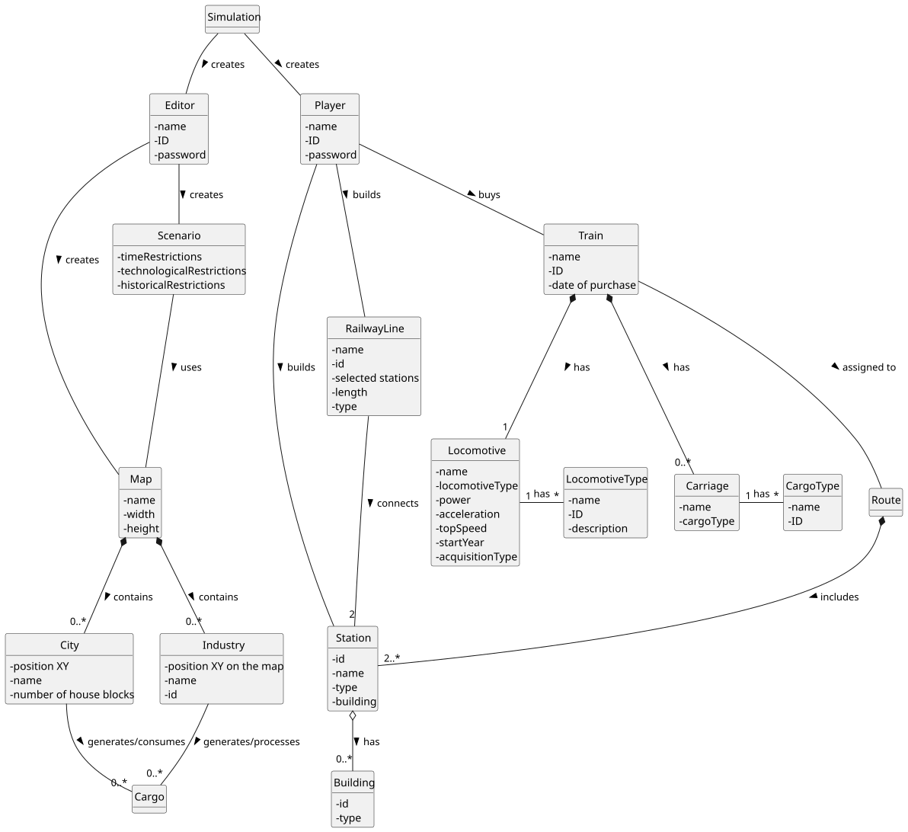

# OO Analysis

The construction process of the domain model is based on the client specifications, especially the nouns (for _concepts_) and verbs (for _relations_) used.

## Rationale to identify domain conceptual classes
To identify domain conceptual classes, start by making a list of candidate conceptual classes inspired by the list of categories suggested in the book "Applying UML and Patterns: An Introduction to Object-Oriented Analysis and Design and Iterative Development".

### _Conceptual Class Category List_

**Business Transactions**

* Cargo Transport
* Train Purchase

---

**Transaction Line Itemss**

* Cargo Shipment

---

**Product/Service related to a Transaction or Transaction Line Item**

* Cargo
* Train Service

---

**Transaction Records**

* Train Journey
* Cargo Delivery

---  

**Roles of People or Organizations**

* Editor
* Player

---

**Places**

* Map
* City
* Station
* Industry Location

---

**Noteworthy Events**

* Cargo Generation
* Train Journey
* Historical Events

---

**Physical Objects**

* Train
* Locomotive
* Carriage
* Railway Line
* Station Building

---

**Descriptions of Things**

* City Description
* Industry Description
* Locomotive Specifications

---

**Catalogs**

* Locomotive Catalog
* Station Building Catalog
* Industry Types Catalog

---

**Containers**

* Map (contains cities and industries)
* Station (stores cargo)
* Train (carries cargo)

---

**Elements of Containers**

* City
* Industry
* Carriage
* Cargo

---

**Organizations**

* Industry

---

**Other External/Collaborating Systems**

* Simulator

---

**Records of finance, work, contracts, legal matters**

* Player Budget
* Train Cost
* Station Building Cost

---

**Financial Instruments**

* Player Budget

---

**Documents mentioned/used to perform some work/**

* Scenario
* Route Plan

---

## Rationale to identify associations between conceptual classes

An association is a relationship between instances of objects that indicates a relevant connection and that is worth of remembering, or it is derivable from the List of Common Associations:

- **_A_** is physically or logically part of **_B_**
- **_A_** is physically or logically contained in/on **_B_**
- **_A_** is a description for **_B_**
- **_A_** known/logged/recorded/reported/captured in **_B_**
- **_A_** uses or manages or owns **_B_**
- **_A_** is related with a transaction (item) of **_B_**
- etc.

| Concept (A) 		|  Association   	|  Concept (B) |
|----------	   		|:-------------:		|------:       |
| Editor  	| creates    		 	| Map  |
| Editor  	| creates    		 	| Scenario  |
| Map  	| contains    		 	| City  |
| Map  	| contains    		 	| Industry  |
| Scenario  	| uses    		 	| Map  |
| Industry  	| is a    		 	| PrimarySectorIndustry  |
| Industry  	| is a    		 	| TransformingIndustry  |
| Industry  	| is a    		 	| MixedIndustry  |
| Station  	| is a    		 	| Depot  |
| Station  	| is a    		 	| RegularStation  |
| Station  	| is a    		 	| Terminal  |
| Station  	| has    		 	| StationBuilding  |
| Station  	| stores    		 	| Cargo  |
| RailwayLine  	| connects    		 	| Station  |
| Player  	| builds    		 	| Station  |
| Player  	| builds    		 	| RailwayLine  |
| Player  	| buys    		 	| Train  |
| Train  	| has    		 	| Locomotive  |
| Train  	| has    		 	| Carriage  |
| Train  	| assigned to    		 	| Route  |
| Route  	| includes    		 	| Station  |
| City  	| generates/consumes    		 	| Cargo  |
| Industry  	| generates/processes    		 	| Cargo  |
| Simulator  	| generates    		 	| Cargo  |

## Domain Model

**Do NOT forget to identify concept atributes too.**

**Insert below the Domain Model Diagram in a SVG format**

