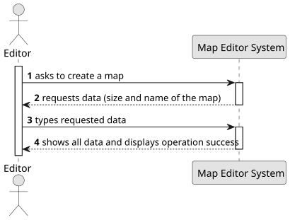

# US001 - Create a map

## 1. Requirements Engineering

### 1.1. User Story Description

As an Editor, I want to create a map with a size and a name.

### 1.2. Customer Specifications and Clarifications

**From the document specifications:**

> The Map Editor allows you to create rectangular maps and place static elements on the map. 
> Elements can be cities or industries.

**From the client clarifications:**

> The map must have a maximum size limit.

### 1.3. Acceptance Criteria

### 1.4. Found out Dependencies

### 1.5 Input and Output Data

**Input Data:**

- Size
- Name

**Output Data:**

- Message of success indicating that the city has been added

### 1.6. System Sequence Diagram (SSD)

_Insert here a SSD depicting the envisioned Actor-System interactions and throughout which data is inputted and outputted to fulfill the requirement. All interactions must be numbered._

### 1.7 Other Relevant Remarks
