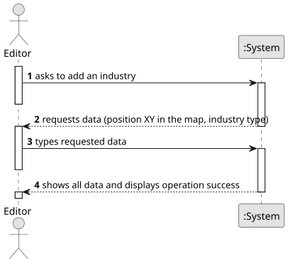

# US002 - Add an industry

## 1. Requirements Engineering

### 1.1. User Story Description

As an Editor, I want to add an industry in a position XY of
the selected map.

### 1.2. Customer Specifications and Clarifications

**From the specifications document:**

> The Map Editor allows you to create rectangular maps and place static elements on the map.
Elements can be cities or industries.
> There are three types of industries: Primary sector industries, Transforming industries and Mixed industries.
> Primary sector industries generate resources, such as mines
(e.g., iron, coal, bauxite, or nitrate mines) and farms (vegetables, cereals, wool, coffee, rubber, cattle). The resources generated by these
units can, if transported by train in the context of the simulator, be
consumed/processed by other types of industries.
> Transforming industries transform the resources provided
by the Primary Sector Industries into new products. This industry includes bakeries, textiles, automobiles, and steel mills. For example, a
steel mill transforms coal and iron ore into steel. The steel produced
can then be transported to an automobile factory and used in the production of automobiles.
> Mixed industries ports potentially have the capacity, depending on
what is defined in the scenario, to import/export any cargo.
> The Scenario Editor must allow the user to define the restrictions and
conditions for using a given map: Time Restrictions, Technological Restrictions and Historical Restrictions.
> Time Restrictions imply the period in which the simulation will take place.
> Technological Restrictions depend on which locomotives or industries are available in the scenario.
> Historical Restrictions imply the historical events that make sense in the scenario and change the operating conditions of the simulator. For instance, a war increases the steel demand, and a vaccination campaign
or a schooling program encourages mail and/or passenger traffic. In
this context, the goods that the Ports import and export are also defined.

**From the client clarifications:**

>
### 1.3. Acceptance Criteria

### 1.4. Found out Dependencies

* There is a dependency with US001 - "Create map", given that to create an industry, there needs to be a map first.

### 1.5 Input and Output Data

**Input Data:**

- Position XY of the industry in the map

**Output Data:**

- Message of success indicating that the industry has been added

### 1.6. System Sequence Diagram (SSD)

### 1.7 Other Relevant Remarks

* No other relevant remarks