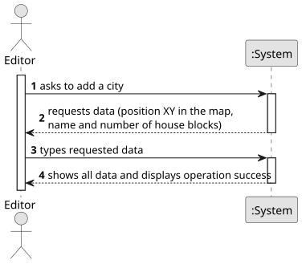

# US003 - Add a city

## 1. Requirements Engineering

### 1.1. User Story Description

As an Editor, I want to add a city in a position XY of the selected
map, with a name and a positive number of house blocks.

### 1.2. Customer Specifications and Clarifications

**From the specifications document:**

> The Map Editor allows you to create rectangular maps and place static elements on the map. 
Elements can be cities or industries.
> A city bears a name, a location (with XY coordinates on the map), and a set
of blocks that represent housing. In the simulator’s context, cities generate
and consume passengers and mail, but they also consume final products (e.g.,
food, textiles, cars).

**From the client clarifications:**

> **Question:** What is the purpose and meaning of the "City Tag"?
> **Answer:**
> 
>
> **Question:** Does the city have a specific radius for some functionality or is the city creation just figurative?
> **Answer:**
> 
>
> **Question:** Does that influence passenger statistics or will there be no statistics for a specific city?
> **Answer:**

### 1.3. Acceptance Criteria

* **AC1:** A city name cannot have special characters or digits.
* **AC2:** The house blocks can be assigned manually or automatically (randomly around the city tag position)
* **AC3:** The number of house blocks needs to be positive 

### 1.4. Found out Dependencies

* There is a dependency with US001 - "Create map", given that to create a city, there needs to be a map first. 

### 1.5 Input and Output Data

**Input Data:**

- Position XY of the city in the map
- Name 
- Number of house blocks 

**Output Data:**

- Message of success indicating that the city has been added 

### 1.6. System Sequence Diagram (SSD)

### 1.7 Other Relevant Remarks

* No other relevant remarks 