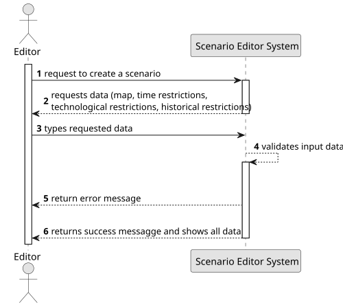

# US004 - Create a scenario

## 1. Requirements Engineering

### 1.1. User Story Description

As an Editor, I want to create a scenario for a selected map.

### 1.2. Customer Specifications and Clarifications

**From the specifications document:**

> The Scenario Editor must allow the user to define the restrictions and
conditions for using a given map, namely:
• Time Restrictions - the period in which the simulation will take place;
• Technological Restrictions - for example, which locomotives or industries are available in the scenario;
• Historical Restrictions - historical events that make sense in the scenario and change the operating conditions of the simulator. For instance, a war increases the steel demand, and a vaccination campaign
or a schooling program encourages mail and/or passenger traffic. In
this context, the goods that the Ports import and export are also defined.

**From the client clarifications:**

> **Question:** Should a scenario have a name and description, or is it only linked to a map?
> **Answer:**
>
>
> **Question:** Will scenarios be importable/exportable between different maps?
> **Answer:**
>
>
> **Question:** Can scenarios be modified after creation, or are they immutable?
> **Answer:**
> 
> 
> **Question:** Should scenarios define specific rules for resource generation and demand in cities and industries?
> **Answer:** 
> 
> 
> **Question:** How should the editor apply the restrictions for the scenario?
> **Answer:** 
> 
> 
> **Question:** How should be scenario be identified (i.e name, brief description)?
> **Answer:**
> 
> 
> **Question:** Can the editor select multiple restrictions in the same scenario?
> **Answer:**
>
>
> **Question:** What happens if an Editor tries to set conflicting restrictions (i.e. allowing a locomotive that hasn't 
been invented yet)?
> **Answer:**
>
>
> **Question:** Can a scenario have multiple versions/be updated after creation, or should it only have the debut 
version?
> **Answer:**
>
>
> **Question:** In one scenario, the editor can choose to import multiple products into the ports?
> **Answer:**
>
>
> **Question:** Regarding the creation of a scenario, does the editor first choose a map to create a scenario on,
or does he create the scenario first and then associate it with a map?
> **Answer:**
>
>
>
 

### 1.3. Acceptance Criteria

> **AC1**: Definition of the behaviour of ports, which cargoes they import/export and/or transform;
> **AC2**: Definition of the available locomotion types (steam, diesel, and/or electric).
> **AC3**: (Re)Definition of the factors that alter the generation (frequency)
of generating industries
> **AC4:** The system must allow the Editor to create a scenario for a selected map.
> **AC5:** A scenario can't be created without an existing map.
> **AC6:** The scenario must require are restrictions (time, historical, technological).
> **AC7:** Each restriction type must include valid inputs (i.e. Time Restrictions must include valid dates, within an 
acceptable range).
> **AC8:** Each scenario must have a unique name (avoid duplicates), and prevent special characters and empty values in the name.
> **AC9:** Each scenario must be linked to exactly one map.
> **AC10:** Upon successful creation, the system must display a confirmation message.
> **AC11:** If creation fails, the system must provide a descriptive error message indicating the cause.
> **AC12:** Only users with "Editor" privileges can create, modify, and manage scenarios.

### 1.4. Found out Dependencies

* There is a dependency with US001 - "Create map" - since a scenario is created for a selected map,
there must be at least one existing map before a scenario can be created. This dependency ensures 
that scenarios are correctly linked to a valid map and prevents orphaned scenarios without a map context.

### 1.5 Input and Output Data

**Input Data:**

- Time restrictions
- Technological restrictions
- Historical restrictions

**Output Data:**

- Message of success indicating that the city has been added
- - Error message, in case of failed scenario creation, indicating failure cause.

### 1.6. System Sequence Diagram (SSD)

### 1.7 Other Relevant Remarks
