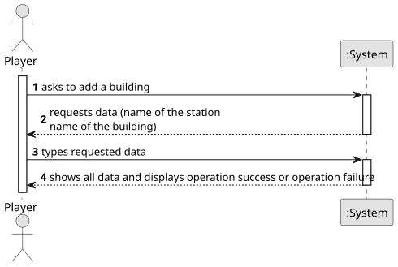

# US006 - Upgrade a selected station with a building

## 1. Requirements Engineering

### 1.1. User Story Description

As a Player, I want to upgrade a selected station with a building

### 1.2. Customer Specifications and Clarifications

**From the specifications document:**

> When built, a station consists of just one building, which can be upgraded
with other buildings that can increase the station’s performance, improve
train operation, facilitate train manoeuvrers, and increase the lifespan of
cargo stored at the station.
> Some of the buildings that can be used to upgrade stations are: telegraph (later telephone), café (small or large), customs, post
office, hotel (small or large), silo, liquid storage.
> Each type of station improvement has a date from which it is available.
> Some equipments are mutually exclusive and some equipments/buildings replace others (the telegraph was initially used to facilitate the operation of trains at stations, and was later
replaced by the telephone, so after the advent of telephone, telegraph
is no more available).

    
**From the client clarifications:**

> 
### 1.3. Acceptance Criteria

### 1.4. Found out Dependencies

* There is a dependency with US005 - "Build a Station", since in order to upgrade a station, it needs to be built.

### 1.5 Input and Output Data

**Input Data:**

- Request to upgrade a station
- The name of the station to be upgrade
- The name of the building that will upgrade the station

**Output Data:**

- Request the station to upgrade
- Shows the buildings available to buy
- Message of success indicating that the building has been added
- Message of failure indicating that the building hasn't been added.

### 1.6. System Sequence Diagram (SSD)

### 1.7 Other Relevant Remarks

* The price list of the upgrades must be established in advance by the system, which the player can request the values of each building to add in the station.