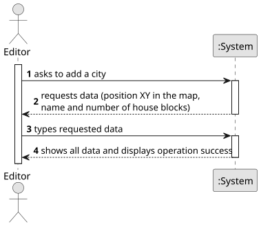

# US003 - Add a city

## 1. Requirements Engineering

### 1.1. User Story Description

As a Player, I want to list all the stations to select one to see its
details, including the existing building and the demand/supply cargoes.

### 1.2. Customer Specifications and Clarifications

**From the specifications document:**

> When viewing a station, in addition to the buildings present, the cargo that is ready for collection
and the cargo that needs to be delivered should also be
displayed.

**From the client clarifications:**

> 
### 1.3. Acceptance Criteria

* **AC1:** A city name cannot have special characters or digits.
* **AC2:** The house blocks can be assigned manually or automatically (randomly around the city tag position)
* **AC3:** The number of house blocks needs to be positive 

### 1.4. Found out Dependencies

* There is a dependency with US001 - "Create map", given that to create a city, there needs to be a map first. 

### 1.5 Input and Output Data

**Input Data:**

- Position XY of the city in the map
- Name 
- Number of house blocks 

**Output Data:**

- Message of success indicating that the city has been added 

### 1.6. System Sequence Diagram (SSD)

### 1.7 Other Relevant Remarks

* 