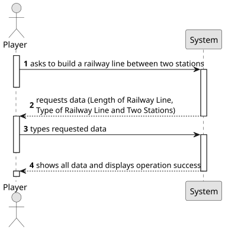

# US003 - Add a city

## 1. Requirements Engineering

### 1.1. User Story Description
As a Player, I want to build a railway line between two stations

### 1.2. Customer Specifications and Clarifications

**From the specifications document:**

> 

**From the client clarifications:**

>
### 1.3. Acceptance Criteria

* **AC1:**  The player should choose the stations from a list of registered
  stations.

### 1.4. Found out Dependencies

* 

### 1.5 Input and Output Data

**Input Data:**

**Output Data:**

### 1.6. System Sequence Diagram (SSD)

### 1.7 Other Relevant Remarks

* No other relevant remarks 