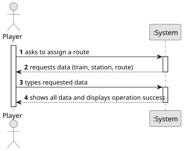

# US010 - Assign a train to a route

## 1. Requirements Engineering

### 1.1. User Story Description

As a Player, I want to assign a selected train to a route with a valid station and the respective list of cargoes to be picked up.

### 1.2. Customer Specifications and Clarifications

**From the specifications document:**

> In the simulator, the player/user acquires trains within the available budget
and can put the train into service on a specific route. A route is a list of
stations where the train passes, along which it loads (carriages) cargo at each
station.

**From the client clarifications:**

> 
### 1.3. Acceptance Criteria

### 1.4. Found out Dependencies

* There is a dependency with US005 - "Build a station", given that to assign a train to a route with a valid station, there needs to be a valid station.
* There is a dependency with US008 - "Build a railway line", given that to assign a train to a route, there needs to be valid railway lines.

### 1.5 Input and Output Data

**Input Data:**

- Desired train
- Desired station
- Desired route
- List of cargoes to be picked up

**Output Data:**

- Message of success indicating that the route has been assigned

### 1.6. System Sequence Diagram (SSD)

### 1.7 Other Relevant Remarks

* 