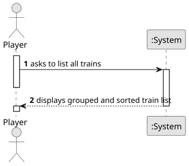

# US011 - List all Trains

## 1. Requirements Engineering

### 1.1. User Story Description

As a Player, I want to list all trains.

### 1.2. Customer Specifications and Clarifications

**From the specifications document:**

> Trains are composed of locomotives and carriages. The locomotives provide traction and can be of 
different types: steam, diesel, or electric. Electric locomotives require electrified lines. Locomotives 
are characterized by several technical aspects, such as power, acceleration, top speed, start year of operation,
and acquisition price.
> In the simulator, the player/user acquires trains within the available budget
and can put the train into service on a specific route. A route is a list of
stations where the train passes, along which it loads (carriages) cargo at each
station.
> The carriages are distinguished by the type of cargo they can transport (e.g., passengers, mail, coal, iron ore, steel, cars)
and, in the simulator, they have no acquisition cost.

**From the client clarifications:**

### 1.3. Acceptance Criteria

**AC1**: The display of trains must include the locomotive and the current cargoes.
**AC2**: The trains should be grouped by locomotive type and then listed alphabetically by name.

### 1.4. Found out Dependencies

* There is a dependency with US009 - "Buy a train", since it is necessary to have trains created to list them.
* There is a dependency with US010 - "Assign a selected train to a route", as cargoes may change depending on the train’s route.

### 1.5 Input and Output Data

**Input Data:**

- Player action requesting the system to list all trains

**Output Data:**

- Display of all trains grouped by locomotive type (steam, diesel and electric) and sorted alphabetically

### 1.6. System Sequence Diagram (SSD)

### 1.7 Other Relevant Remarks

* 