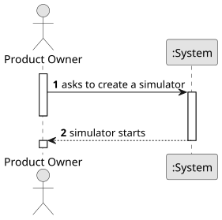

# US012 - Create a simulator

## 1. Requirements Engineering

### 1.1. User Story Description

As a Product Owner, I want to create a simulator that generates
cargoes at current stations, automatically, considering the cities and
industries that the railway network serves.

### 1.2. Customer Specifications and Clarifications

**From the specifications document:**

> In addition to creating the dynamic elements already described, the player/user
can play or pause the simulator. During the simulator’s operation, the evolution of events should be displayed, namely the trains’ journeys (start and
end).

**From the client clarifications:**

> 
### 1.3. Acceptance Criteria

* **AC1:** This simulator should provide options for start/pause.

### 1.4. Found out Dependencies

* There is a dependency with all previous user stories, since that in order to run a simulation, there must be a way to create everything needed.

### 1.5 Input and Output Data

**Input Data:**

- Start button

**Output Data:**

- Message of success indicating that the simulation has started 

### 1.6. System Sequence Diagram (SSD)

### 1.7 Other Relevant Remarks

* 