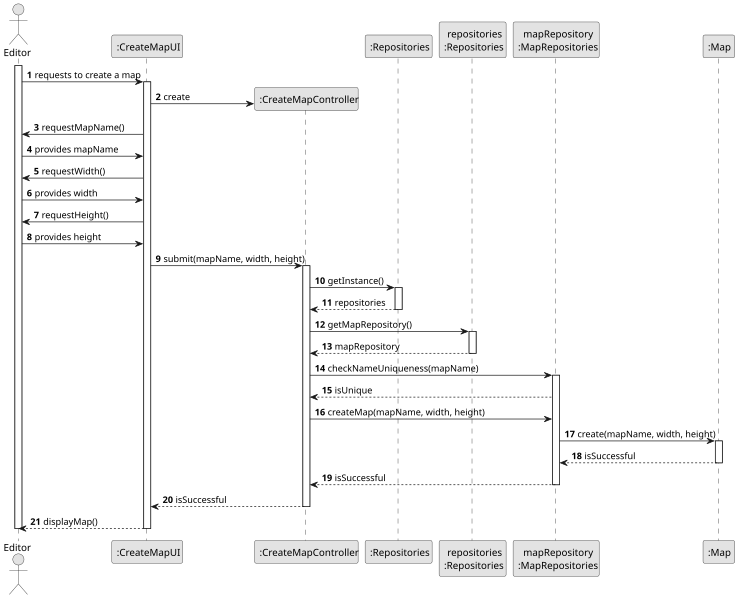
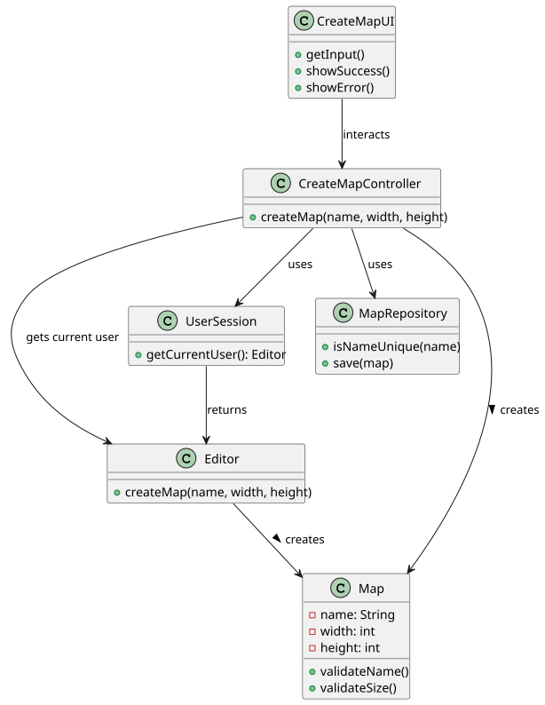

# US001 - Create a map

## 3. Design

### 3.1. Rationale

| Interaction ID | Question: Which class is responsible for...         | Answer              | Justification (with patterns)                                                                                      |
|:--------------|:----------------------------------------------------|:--------------------|:-------------------------------------------------------------------------------------------------------------------|
| Step 1        | ... interacting with the actor?                     | CreateMapUI         | Pure Fabrication: handles user interactions and there's no existing domain class suitable for this responsibility. |
|               | ... coordinating the US?                            | CreateMapController | Controller: coordinates the creation process and delegates to domain classes.                                      |
|               | ... knowing the user using the system?              | UserSession         | IE: part of A&A component, knows current user.                                                                     |
|               | ... ensuring name uniqueness and compliance?        | MapRepository       | HC/LC: central point for checking existing map names and constrains.                                               |
| Step 2        | ... receiving input name and dimensions?            | CreateMapUI         | IE: responsible for capturing user input.                                                                          |
| Step 3        | ... validating input (local name and size)?         | Map                 | IE: owns and validates its own data (name, size) locally.                                                          |
| Step 4        | ... validating global constrains (uniqueness, etc)? | MapRepository       | IE: responsible for managing all maps; knows names already in use.                                                 |
| Step 5        | ... initiating a new Map?                           | Editor              | Creator: in the domain model, the Editor creates and manages Maps.                                                 |
| Step 6        | ... saving the created map?                         | MapRepository       | IE: owns and persists all maps.                                                                                    |
| Step 7        | ... informing operation success/failure?            | CreateMapUI         | IE: responsible for user interaction feedback.                                                                     || |                                                                         | 

### Systematization ##

According to the taken rationale, the conceptual classes promoted to software classes are:

* Editor
* Map

Other software classes (i.e. Pure Fabrication) identified:

* CreateMapUI
* CreateMapController
* MapRepository
* ApplicationSession
* UserSession

## 3.2. Sequence Diagram (SD)

### Full Diagram

This diagram shows the full sequence of interactions between the classes involved in the realization of this user story.

## 3.3. Class Diagram (CD)

