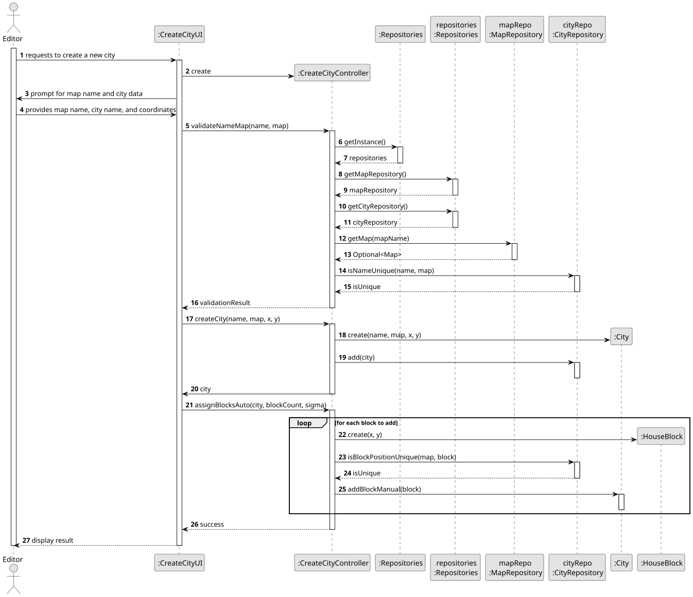
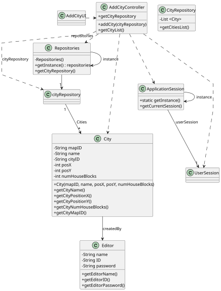

# US003 - Add a City 

## 3. Design

### 3.1. Rationale

**The rationale grounds on the SSD interactions and the identified input/output data.**

| Interaction ID | Question: Which class is responsible for...       | Answer            | Justification (with patterns)                                                                               |
|:---------------|:--------------------------------------------------|:------------------|:------------------------------------------------------------------------------------------------------------|
| Step 1         | ...asking to add a city?                          | AddCityUI         | **Pure Fabrication**: UI initiation is not a responsibility of any domain class. It fabricates interaction. |
|                | ...coordinating the US?                           | AddCityController | **Controller**: Handles system operations initiated by the user (Editor).                                   |
|                | ...instantiating the class that handles the UI?   | AddCityUI         | **Pure Fabrication**: No domain object is responsible for UI instantiation.                                 |
| Step 2         | ...requesting data from the user?                 | AddCityController | **Controller**: Responsible for initiating communication to get user input.                                 |
| Step 3         | ...typing/providing the data?                     | Editor            | **Role Assignment**: The actor (Editor) provides input data as requested.                                   |
| Step 4         | ...validating and processing the provided data?   | AddCityController | **Controller**: Takes user input, processes or delegates it further.                                        |
| Step 5         | ...creating the city object with input data?      | City              | **Information Expert**: City is the expert on its own creation and holds its data (name, XY, blocks).       |
| Step 6         | ...showing the operation success?                 | AddCityUI         | **Pure Fabrication**: UI class presents success messages to the user.                                       |
| Step 7         | ...storing the new city into the system?          | CityRepository    | **Information Expert / Low Coupling**: Specialized class for data persistence.                              |
| Step 8         | ...displaying all city data?                      | AddCityUI         | **Pure Fabrication**: UI handles output/display logic.                                                      |
| Step 9         | ...coordinating between UI and Domain for flow?   | AddCityController | **Controller**: Central coordinator for user-system interaction.                                            |
| Step 10        | ...initializing the process based on user action? | AddCityController | **Controller**: Handles initial request from Editor and manages the use case.                               |

### Systematization ##

According to the taken rationale, the conceptual classes promoted to software classes are:

* City
* CityRepository
* Editor

Other software classes (i.e., Pure Fabrication) identified:

* AddCityUI
* AddCityController

## 3.2. Sequence Diagram (SD)

## 3.3. Class Diagram (CD)

