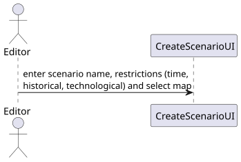
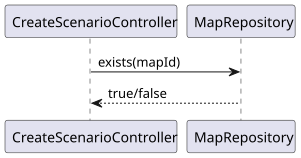
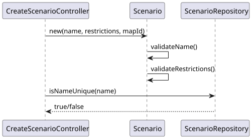
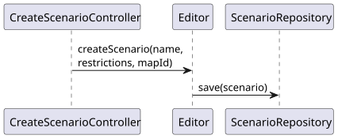
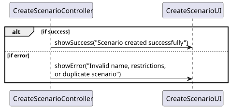

# US004 - Create a scenario

## 3. Design

### 3.1. Rationale

| Interaction ID | Question: Which class is responsible for...                             | Answer                   | Justification (with patterns)                                                                                      |
|:---------------|:------------------------------------------------------------------------|:-------------------------|:-------------------------------------------------------------------------------------------------------------------|
| Step 1         | ... interacting with the actor?                                         | CreateScenarioUI         | Pure Fabrication: handles user interactions and there's no existing domain class suitable for this responsibility. |
|                | ... gathering all the required input (scenario details, map selection)? | CreateScenarioUI         | Controller: coordinates the creation process and delegates to domain classes.                                      |
| Step 2         | ... coordinating the use case?                                          | CreateScenarioController | IE: part of A&A component, knows current user.                                                                     |
| Step 3         | ... obtaining the current user session?                                 | UserSession              | HC/LC: central point for checking existing map names and constrains.                                               |
| Step 4         | ... validating the scenario’s own data (name, restrictions)?            | Scenario                 | IE: responsible for capturing user input.                                                                          |
| Step 5         | ... enforcing global constraints (unique scenario names, existing map)? | ScenarioRepository       | IE: owns and validates its own data (name, size) locally.                                                          |
| Step 6         | ... creating a new Scenario?                                            | Editor                   | IE: responsible for managing all maps; knows names already in use.                                                 |
| Step 7         | ... saving the created scenario?                                        | ScenarioRepository       | Creator: in the domain model, the Editor creates and manages Maps.                                                 |
| Step 8         | ...  informing the Editor of the outcome?                               | CreateScenarioUI         | IE: owns and persists all maps.                                                                                    |

### Systematization ##

According to the taken rationale, the conceptual classes promoted to software classes are:

* Editor
* Map
* Scenario

Pure Fabrication Classes:

* CreateScenarioUI
* CreateScenarioController
* ScenarioRepository
* UserSession

## 3.2. Sequence Diagram (SD)

### Full Diagram

This diagram shows the full sequence of interactions between the classes involved in the realization of this user story.

### Split Diagrams

The following diagram shows the same sequence of interactions between the classes involved in the realization of this user story, but it is split in partial diagrams to better illustrate the interactions between the classes.

It uses Interaction Occurrence (a.k.a. Interaction Use).

**Get Scenario Data**

**Validate Selected Map**

**Validate Scenario Data**

**Create and Save Scenario**

**Show Confirmation or Error**

## 3.3. Class Diagram (CD)

