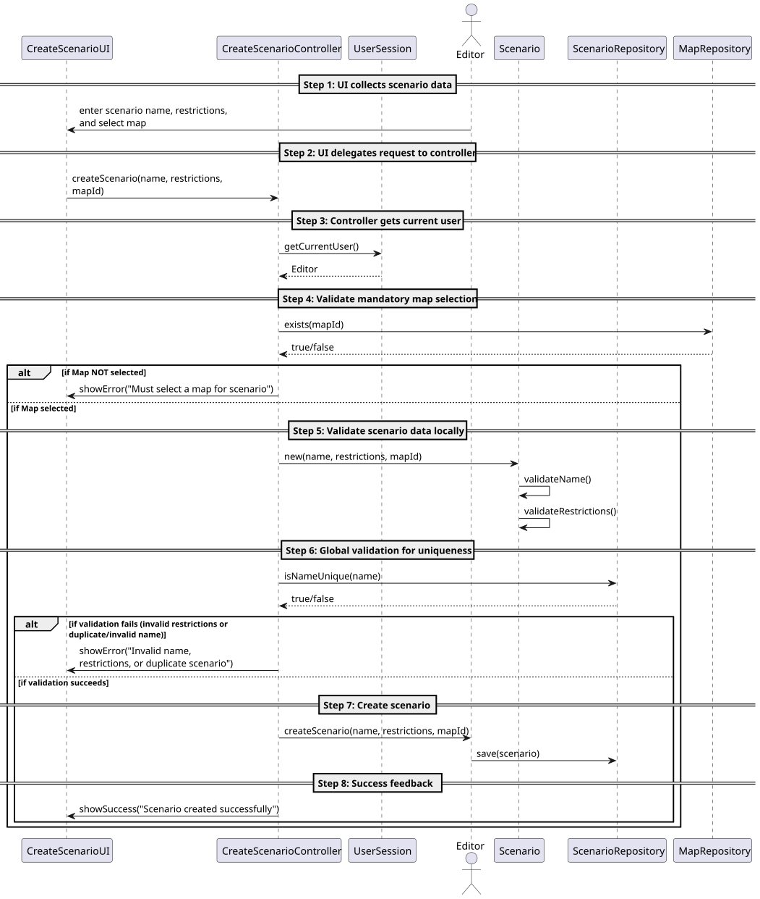
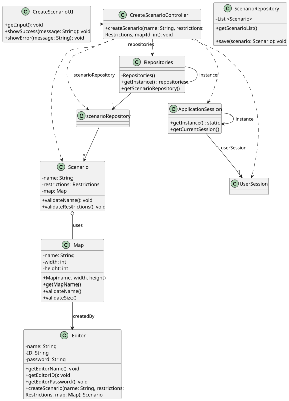

# US004 - Create a scenario

## 3. Design

### 3.1. Rationale

| Interaction ID | Question: Which class is responsible for...                             | Answer                   | Justification (with patterns)                                                                                                                                                                                                                                                                    |
|:---------------|:------------------------------------------------------------------------|:-------------------------|:-------------------------------------------------------------------------------------------------------------------------------------------------------------------------------------------------------------------------------------------------------------------------------------------------|
| Step 1         | ... interacting with the actor?                                         | CreateScenarioUI         | Pure Fabrication: A dedicated UI class to handle all interactions with the Editor during scenario creation.                                                                                                                                                                                      |
|                | ... gathering all the required input (scenario details, map selection)? | CreateScenarioUI         | IE: Responsible for capturing data such as scenario name, restrictions (time, historical, technological), and the selected map.                                                                                                                                                                  |
| Step 2         | ... coordinating the use case?                                          | CreateScenarioController | Controller: Orchestrates the creation process by coordinating input validations, map selection checks, and invoking domain operations.                                                                                                                                                           |
| Step 3         | ... obtaining the current user session?                                 | UserSession              | IE: Retrieves the Editor user context, ensuring only valid users perform scenario creation.                                                                                                                                                                                                      |
| Step 4         | ... validating the scenario’s own data (name, restrictions)?            | Scenario                 | IE: The Scenario entity is responsible for validating its properties (e.g., checking that the name is unique, follows constraints, and that restrictions are valid).                                                                                                                             |
| Step 5         | ... enforcing global constraints (unique scenario names, existing map)? | ScenarioRepository       | HC/LC: The repository maintains scenarios and verifies that names are unique and that the scenario is linked to an existing Map.                                                                                                                                                                 |
| Step 6         | ... creating a new Scenario?                                            | Editor                   | Creator Pattern: The Editor (as a domain role) instantiates a new scenario once all validations pass, ensuring the scenario is linked to a valid map.                                                                                                                                            |
| Step 7         | ... saving the created scenario?                                        | ScenarioRepository       | IE: Manages persistence of the scenario; responsible for storage and retrieval.                                                                                                                                                                                                                  |
| Step 8         | ...  informing the Editor of the outcome?                               | CreateScenarioUI         | IE: Provides feedback (success or error) back to the user based on the outcome of the creation process.                                                                                                                                                                                          |

### Systematization ##

According to the taken rationale, the conceptual classes promoted to software classes are:

* Editor
* Map
* Scenario

Pure Fabrication Classes:

* CreateScenarioUI
* CreateScenarioController
* ScenarioRepository
* UserSession

## 3.2. Sequence Diagram (SD)

### Full Diagram

This diagram shows the full sequence of interactions between the classes involved in the realization of this user story.

## 3.3. Class Diagram (CD)

