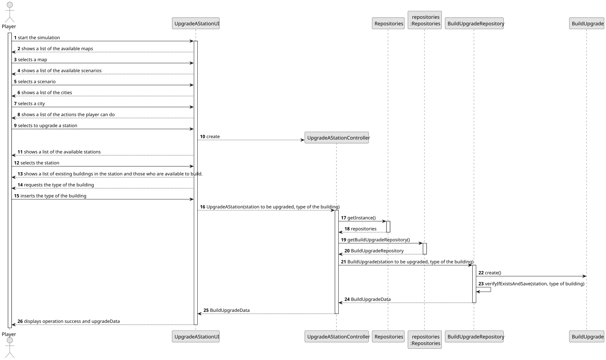

# US005 - Add a Station

## 3. Design

### 3.1. Rationale

**The rationale grounds on the SSD interactions and the identified input/output data.**

| Interaction ID | Question: Which class is responsible for... | Answer                | Justification (with patterns)                                                             |
|:---------------|:--------------------------------------------|:----------------------|:------------------------------------------------------------------------------------------|
| Step 1         | ... asking to add a station?                | AddAStationUI         | **Pure Fabrication**: UI layer is responsible for managing the interaction with the user. |
| Step 2         | ... showing a list of all station types?    | AddAStationUI         | **Pure Fabrication**: UI layer is responsible for showing the available stations types.   |
| Step 3         | ... asking the type of the station?         | AddAStationUI         | **Pure Fabrication**: UI layer is responsible for asking the types of station.            |
| Step 4         | ... select a station type to add?           | Player                | **Role Assignment**: The player is responsible to choose a station to add.                |
| Step 5         | ... adds the selected station type?         | AddAStationController | **Controller**: Adds the requested station type.                                          |
| Step 6         | ... save the station data?                  | AddAStationController | **Controller**: Saves the station on the map.                                             |

### Systematization ##

According to the taken rationale, the conceptual classes promoted to software classes are: 

* Player
* Station

Other software classes (i.e. Pure Fabrication) identified: 

* AddAStationUI  
* AddAStationController

## 3.2. Sequence Diagram (SD)

### Full Diagram

This diagram shows the full sequence of interactions between the classes involved in the realization of this user story.

## 3.3. Class Diagram (CD)

