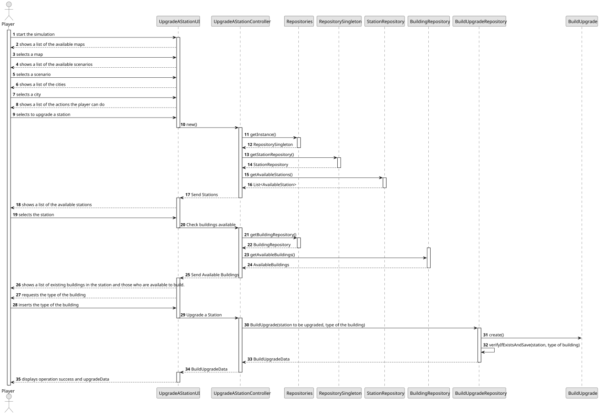
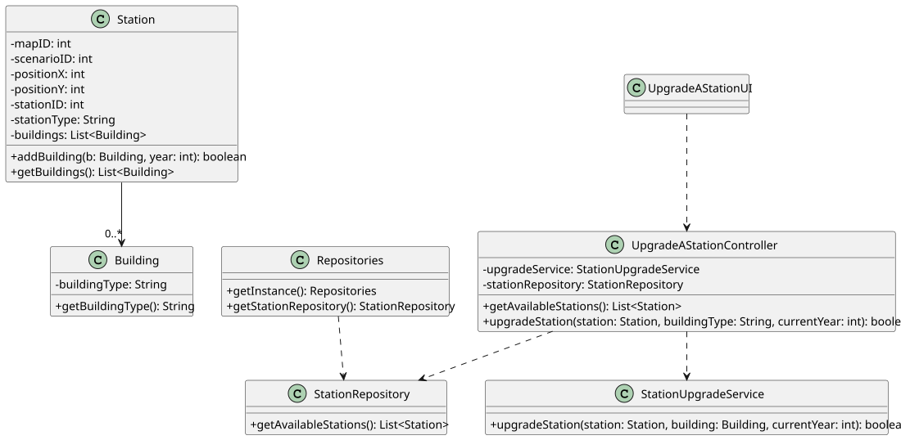

# US006 - Upgrade a selected station with a building

## 3. Design

### 3.1. Rationale

| Interaction ID | Question: Which class is responsible for...                       | Answer                    | Justification (with patterns)                                                                                             |
|:---------------|:------------------------------------------------------------------|:--------------------------|:--------------------------------------------------------------------------------------------------------------------------|
| Step 1         | ... requesting to upgrade a station?                              | UpgradeAStationUI         | Pure Fabrication: UI layer is responsible for managing the interaction with the user.                                     |
| Step 2         | ... showing a list of available stations?                         | UpgradeAStationUI         | Pure Fabrication: UI layer is responsible for displaying the available stations to upgrade.                               |
| Step 3         | ... select a station to upgrade?                                  | Player                    | Role Assignment: The player is responsible to choose a station to upgrade (construct a building).                         |
| Step 4         | ... showing a list of existing buildings and available buildings? | UpgradeAStationUI         | Pure Fabrication: UI layer is responsible for displaying the available buildings and existing buildings in the station.   |
| Step 5         | ... asking the type of the building?                              | UpgradeAStationUI         | Pure Fabrication: UI layer is responsible for requesting an available type of building.                                   |
| Step 6         | ... typing the type of the building?                              | Player                    | Role Assignment: The player is responsible to choose a type of building.                                                  |
| Step 7         | ... finalizing the selection of building?                         | UpgradeAStationController | Controller: Coordinates the completion of selection process.                                                              |
| Step 8         | ... completion of the selection?                                  | UpgradeAStationUI         | Pure Fabrication: UI layer confirms the completion of the selection process.                                              |
| Step 9         | ... coordinating the whole flow?                                  | UpgradeAStationController | Controller: Orchestrates the interaction between UI, domain classes, and logic.                                           |
| Step 10        | ... showing details of the purchase of the building?              | UpgradeAStationUI         | Pure Fabrication: UI layer is responsible to display the purchase details.                                                |
| Step 11        | ... storing the details of the building?                          | Station                   | Information Expert: Domain class is responsible to store all information about the building (the effects and the type).   |
| Step 12        | ... providing the list of available building                      | Station                   | Information Expert: Domain class is responsible to store all information about the building (the effects and the type).   |

### Systematization

According to the taken rationale, the conceptual classes promoted to software classes are:

- Player
- Station
- Building

Other software classes (i.e. Pure Fabrication) identified:

- UpgradeAStationUI
- UpgradeAStationController

## 3.2. Sequence Diagram (SD)

### Full Diagram

This diagram shows the full sequence of interactions between the classes involved in the realization of this user story.

### Partial Diagrams

- `us006-sd-partial-upgrade-station.puml`
- `us006-sd-partial-add-building.puml`
- `us006-sd-partial-check-mutual-exclusivity.puml`

## 3.3. Class Diagram (CD)

