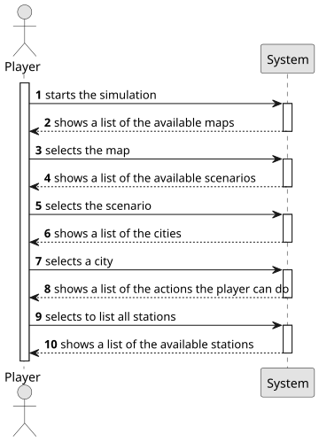

# US007 - List all the stations

## 1. Requirements Engineering

### 1.1. User Story Description

As a Player, I want to list all the stations to select one to see its
details, including the existing building and the demand/supply cargoes.

### 1.2. Customer Specifications and Clarifications

**From the specifications document:**

> When viewing a station, in addition to the buildings present, the cargo that is ready for collection
and the cargo that needs to be delivered should also be
displayed.
> There are three types of stations: Depots (50k, 3x3 radius), 
Stations (100k, 4x4 radius), and Terminals (200k, 5x5 radius). Their cost and economic radius distinguish the stations.
> All industrial and population sites within the radius of a station send (supply) and receive (demand) business through the station. 
By adding the supply and demand for cargoes from the industry and population in a range, the supply and demand for the station are determined.
> When built, a station consists of just one building, which can be upgraded with other buildings that can increase the station’s performance,
improve train operation, facilitate train manoeuvrers, and increase the lifespan of cargo stored at the station.
> Some of the buildings that can be used to upgrade stations are: telegraph (later telephone), café (small or large), 
customs, post office, hotel (small or large), silo, liquid storage.

**From the client clarifications:**

> **Question:** Should the list be sorted in any particular way? (e.g., by name, by cargo volume, etc.)?

> **Answer:** To be determined.

> **Question:** Will the player be able to apply filters to the list? If so, which ones would be useful? (e.g., only active ones, by type, by region…)?

> **Answer:** To be determined.

> **Question:** What information should be visible directly in the list? Just the station name, or also other details like type, location, and operation status (active/inactive), etc.? 

> **Answer**: Name and a summary of available cargos to be collected and the ones that are demanded.

> **Question**: Besides the existing buildings and demand/supply cargo, are there any other details that sould be shown when viewwing a station's information? For example, location, capacity, or operational status?

> **Answer**: Available cargos to be collected and the ones that are demanded.

### 1.3. Acceptance Criteria

**AC1:** Stations must be listed in alphabetical order by name.

### 1.4. Found out Dependencies

* There is a dependency with US005 - "Create a Station", it's necessary to have stations to list them.
* There is a dependency with US006 - "Upgrade a selected Station", in order to verify the details from a station, it's necessary to have a option that can modify it.

### 1.5 Input and Output Data

**Input Data:**

- Select to list all stations

**Output Data:**

- Display all stations sorted by alphabetical name, with the name and a summary of available cargos to be collected and the ones that are demanded. 

### 1.6. System Sequence Diagram (SSD)

### 1.7 Other Relevant Remarks

* 