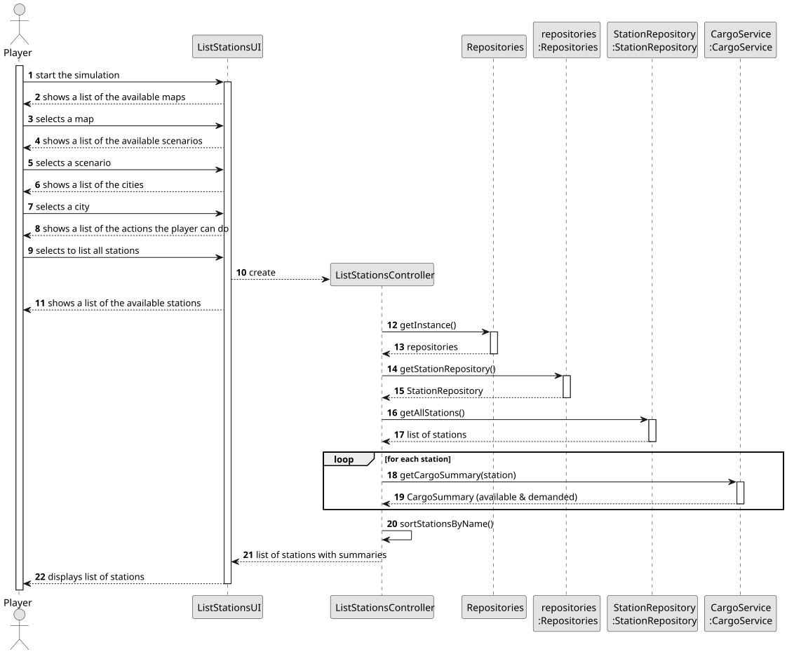
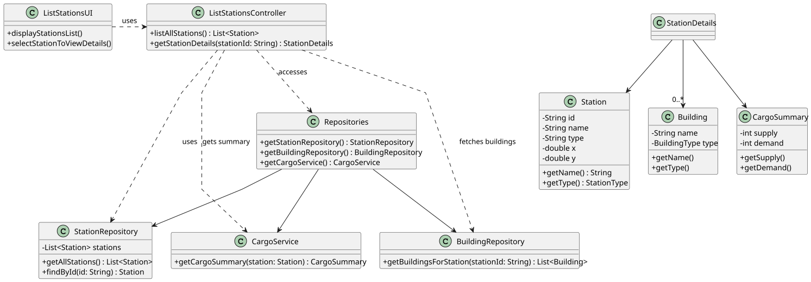

# US007 - List all the stations

## 3. Design

### 3.1. Rationale

| Interaction ID | Question: Which class is responsible for...           | Answer                 | Justification (with patterns)                                                                                                       |
|:---------------|:------------------------------------------------------|:-----------------------|:------------------------------------------------------------------------------------------------------------------------------------|
| Step 1         | ... requesting to list all stations?                  | ListStationsUI         | Pure Fabrication: UI layer is responsible for managing the interaction with the user.                                               |
| Step 2         | ... showing a list of available stations?             | ListStationsUI         | Pure Fabrication: UI layer is responsible for displaying the available stations listed.                                             |
| Step 3         | ... coordinating the flow to obtain the station data? | ListStationsController | Controller: Coordinates between the UI and the domain logic, encapsulating the use case logic                                       |
| Step 4         | ... storing all existing stations?                    | StationRepository      | Information Expert: Responsible for managing and returning all station data.                                                        |
| Step 5         | ... obtaining the summary of each station?            | CargoService           | Information Expert: Knows and manages station data.                                                                                 |
| Step 6         | ... sorting stations by name?                         | ListStationsController | Controller: Responsible for preparing data before passing it to the UI.                                                             |

### Systematization ##

According to the taken rationale, the conceptual classes promoted to software classes are: 

* Player
* Station
* Building
* Cargo Summary

Other software classes (i.e. Pure Fabrication) identified: 

* ListStationsUI  
* ListStationsController
* Repositories
* RepositorySingleton
* StationRepository
* CargoService

## 3.2. Sequence Diagram (SD)

### Full Diagram

This diagram shows the full sequence of interactions between the classes involved in the realization of this user story.

## 3.3. Class Diagram (CD)

