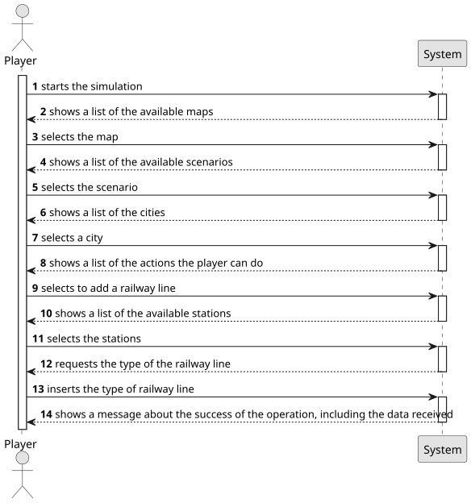

# US008 - Build a railway station between two stations

## 1. Requirements Engineering

### 1.1. User Story Description

As a Player, I want to build a railway line between two stations.

### 1.2. Customer Specifications and Clarifications

**From the specifications document:**

> Railway Lines allow the connection of two stations. In the context of this
project, it is not intended to make a detailed graphical edition of the route,
but only a topological representation of the connection between two stations.
A line has a certain length, can be single or double, and can be electrified
(or not).

**From the client clarifications:**

> **Question:** Does the type of station affect the type of railway lines that can be built?
> **Answer:** No.
> 
> **Question:** Can there be railway lines of the same type between the same stations?
> **Answer:** There cannot be more than one line between a pair of stations, but the existing line can be upgraded.

### 1.3. Acceptance Criteria

* **AC1:** The player should choose the stations from a list of registered
  stations.
* **AC2:** The length of the railway line can't be less than the Manhattan distance between the stations.

### 1.4. Found out Dependencies

* There is a dependency with US001 - "Create map", given that to build a railway line, there needs to be a map first.
* There is a dependency with US005 - "Build a station", given that to build a railway line between two stations, there needs to be two stations first.

### 1.5 Input and Output Data

**Input Data:**
* **Typed data:**
- Length of the railway line.

* **Selected data:**
- Map
- Scenario
- City
- Two stations
- Type of railway line

**Output Data:**

- Message of success indicating that the player has built the railway line

### 1.6. System Sequence Diagram (SSD)

### 1.7 Other Relevant Remarks

* No other relevant remarks