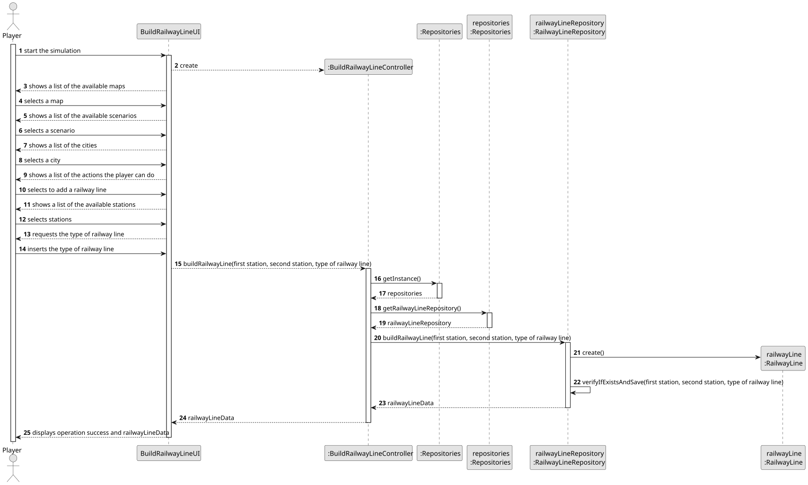
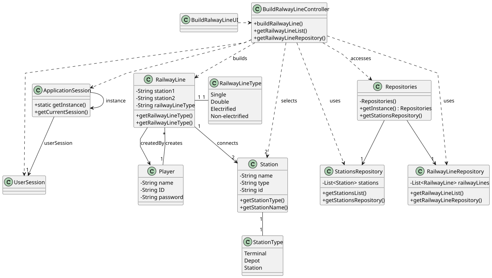

# US008 - Build a railway line between stations

## 3. Design

### 3.1. Rationale

**The rationale grounds on the SSD interactions and the identified input/output data.**

| Interaction ID | Question: Which class is responsible for...                            | Answer             | Justification (with patterns)                                                                 |
|:---------------|:-----------------------------------------------------------------------|:-------------------|:----------------------------------------------------------------------------------------------|
| Step 1         | ...requesting to build a railway line?                                 | BuyTrainUI         | **Pure Fabrication**: UI layer handles initiating user interaction.                           |
| Step 2         | ...displaying list of available stations?                              | BuyTrainUI         | **Pure Fabrication**: UI is responsible for presenting available options to the user.         |
| Step 3         | ...selecting two stations?                                             | Player             | **Role Assignment**: The actor (Player) makes the selection based on displayed data.          |
| Step 4         | ...asking the type of railway line?                                    | BuyTrainUI         | **Pure Fabrication**: UI prompts the user with further interaction options.                   |
| Step 5         | ...typing the type of railway line?                                    | Player             | **Role Assignment**: The actor continues the data input process.                              |
| Step 6         | ...finalizing the selection?                                           | BuyTrainController | **Controller**: Coordinates the completion of the selection process.                          |
| Step 7         | ...confirming the selection?                                           | BuyTrainUI         | **Pure Fabrication**: UI confirms to the player that their selection is acknowledged.         |
| Step 8         | ...coordinating the whole flow (build railway line use case)?          | BuyTrainController | **Controller**: Orchestrates the interaction between UI, domain classes, and logic.           |
| Step 9         | ...showing purchase details (selected stations + railway line length)? | BuyTrainUI         | **Pure Fabrication**: Responsible for displaying the final summary of the transaction.        |
| Step 10        | ...storing the final railway line purchase?                            | RailwayLine        | **Information Expert**: Domain class knows how to store/manage railway line composition data. |

### Systematization ##

**According to the taken rationale, the conceptual classes promoted to software classes are:**

* RailwayLine
* Station
* Player

**Other software classes (i.e., Pure Fabrication) identified:**

* BuildRailwayLineUI
* BuildRailwayLineController

## 3.2. Sequence Diagram (SD)

## 3.3. Class Diagram (CD)

