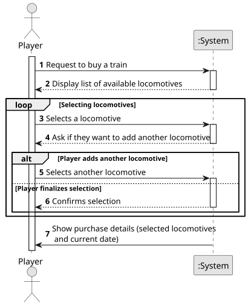

# US009 - Buy a train

## 1. Requirements Engineering

### 1.1. User Story Description

As a Player, I want to buy a train.

### 1.2. Customer Specifications and Clarifications

**From the specifications document:**

> In addition to the structural and economic aspects of railways, trains and railways are a recurring
theme in computer games, allowing experimentation from a playful and entertainment perspective, involving some of the complexity inherent to the
subject.
> The simulator will enable the manager (or in the playful perspective, the
player) to create a railway network composed of stations that serve cities
and industries, lines connecting those stations, and trains that transport
cargo between stations, according to a route defined by the manager
> Trains are composed of locomotives and carriages. The locomotives provide
traction to the composition (train) and can be of different types, namely,
run by steam, diesel, and electricity. Note that electric locomotives require
electrified lines. The locomotives are characterized by several technical aspects, 
such as power, acceleration, top speed, start year of operation, and
acquisition price. The carriages are distinguished by the type of cargo they
can transport (e.g., passengers, mail, coal, iron ore, steel, cars) and, in the
context of the simulator, they have no acquisition cost.
> In the simulator, the player/user acquires trains within the available budget
and can put the train into service on a specific route.

**From the client clarifications:**

> **Question:** Can a player buy the same train multiple times?
> **Answer:** the same type of locomitve, yes; but these locomotives will have unique identification (like a plate or a serial number)
>
> **Question:** Is there a limit to how many trains a player can own, like a inventory that can get full?
> **Answer:** there is no physical limit, just the available memory.
> 
> **Question:** How is the selection list of locomotives determined?
> **Answer:** The locomotives that will be presented in the selection list are restricted to the current date and any restrictions that may have been defined in the scenario.
The presentation of the list of locomotives is part of US09.
> 
> 
> **Question:** How is the availability of locomotives determined?
> **Answer:** Each locomotive model has a one-year entry into service period, after which it becomes available for purchase.
> 
> 
> **Question:**  Is there a limit to the number of locomotives a player can buy?
> **Answer:** No limit.
### 1.3. Acceptance Criteria

* **AC1:** The player should 
choose the locomotive from a list of available locomotives for the scenario as well as a current date.
* **AC2:** The locomotives have to have a serial number (an ID)
* **AC3:** The locomotives should have registered the date for the one-year entry into service period

### 1.4. Found out Dependencies

* No dependency was found with other User Stories 

### 1.5 Input and Output Data

**Input Data:**

* **Selected data:**
  - Locomotive to add to the train 
* **Typed data:**
  - Current date

**Output Data:**

- Message of success indicating the success of the purchase 

### 1.6. System Sequence Diagram (SSD)

### 1.7 Other Relevant Remarks

* No other relevant remarks 