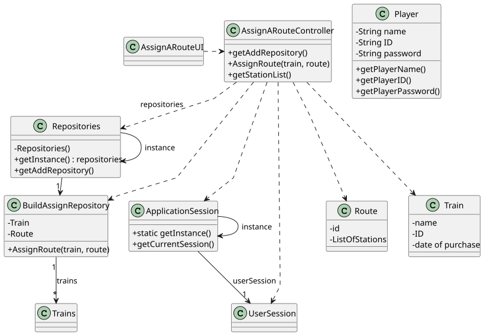

# US010 - Assign a train to a route

## 3. Design

### 3.1. Rationale

**The rationale grounds on the SSD interactions and the identified input/output data.**

| Interaction ID | Question: Which class is responsible for... | Answer                 | Justification (with patterns)                                                             |
|:---------------|:--------------------------------------------|:-----------------------|:------------------------------------------------------------------------------------------|
| Step 1         | ... asking to assign a train to a route?    | AssignARouteUI         | **Pure Fabrication**: UI layer is responsible for managing the interaction with the user. |
| Step 2         | ... showing a list of all available routes? | AssignARouteUI         | **Pure Fabrication**: UI layer is responsible for showing the available routes.           |
| Step 3         | ... showing a list of all available trains? | AssignARouteUI         | **Pure Fabrication**: UI layer is responsible for showing the available trains.           |
| Step 4         | ... select a train to assign?               | Player                 | **Role Assignment**: The player is responsible to choose a train to assign.               |
| Step 5         | ... select a route to assign?               | Player                 | **Role Assignment**: The player is responsible to choose a route to assign.               |
| Step 6         | ... save the train data?                    | AssignARouteController | **Controller**: Saves the route that the train must take.                                 |

### Systematization ##

According to the taken rationale, the conceptual classes promoted to software classes are: 

* Player
* Train
* Route

Other software classes (i.e. Pure Fabrication) identified: 

* AssignARouteUI  
* AssignARouteController

## 3.2. Sequence Diagram (SD)

### Full Diagram

This diagram shows the full sequence of interactions between the classes involved in the realization of this user story.

## 3.3. Class Diagram (CD)

