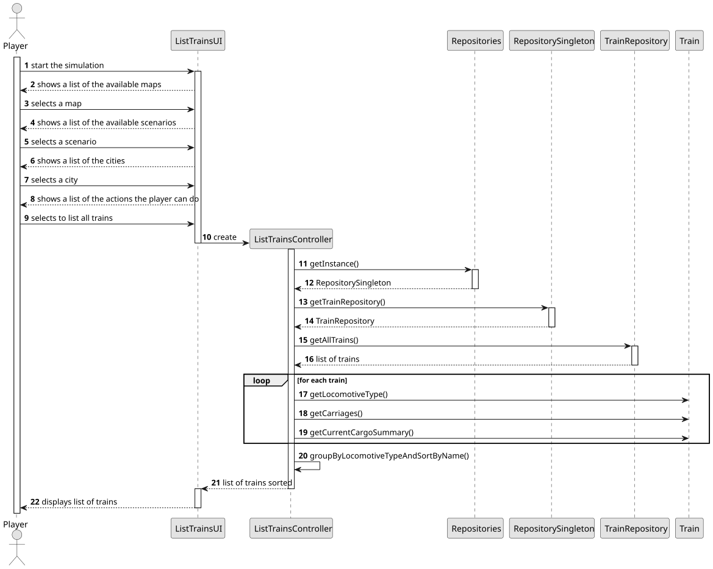
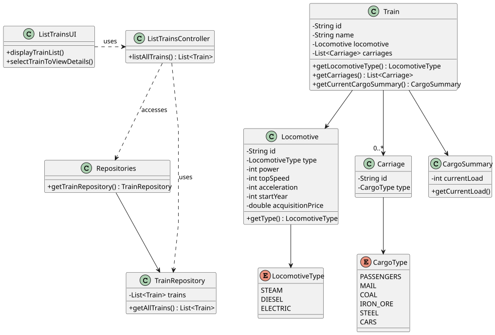

# US011 - List all Trains

## 3. Design

### 3.1. Rationale

| Interaction ID | Question: Which class is responsible for...                  | Answer                | Justification (with patterns)                                                                                                       |
|:---------------|:-------------------------------------------------------------|:----------------------|:------------------------------------------------------------------------------------------------------------------------------------|
| Step 1         | ... requesting to list all trains?                           | ListTrainsUI          | Pure Fabrication: UI layer is responsible for managing the interaction with the user.                                               |
| Step 2         | ... showing a list of available trains?                      | ListTrainsUI          | Pure Fabrication: UI layer is responsible for displaying the available stations listed.                                             |
| Step 3         | ... coordinating the flow to obtain the train data?          | ListTrainsController  | Controller: Coordinates between the UI and the domain logic, encapsulating the use case logic                                       |
| Step 4         | ... storing all existing trains?                             | TrainRepository       | Information Expert: Responsible for managing and returning all station data.                                                        |
| Step 5         | ... representing each train's components and cargoes?        | Train                 | Information Expert: Knows and manages station data.                                                                                 |
| Step 6         | ... grouping by locomotive type and sorting alphabetically?  | ListTrainsController  | Controller: Responsible for preparing data before passing it to the UI.                                                             |

### Systematization ##

According to the taken rationale, the conceptual classes promoted to software classes are: 

* Player
* Train
* Locomotive
* Cargo Carriage
* Cargo Summary

Other software classes (i.e. Pure Fabrication) identified: 

* ListTrainsUI  
* ListTrainsController
* Repositories
* TrainRepository

## 3.2. Sequence Diagram (SD)

### Full Diagram

This diagram shows the full sequence of interactions between the classes involved in the realization of this user story.

## 3.3. Class Diagram (CD)

