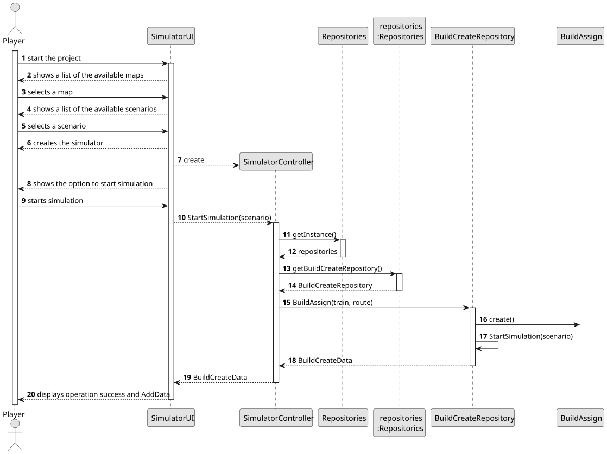
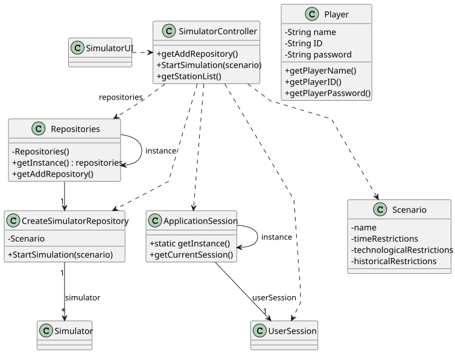

# US012 - Create a simulator

## 3. Design

### 3.1. Rationale

**The rationale grounds on the SSD interactions and the identified input/output data.**

| Interaction ID | Question: Which class is responsible for...    | Answer              | Justification (with patterns)                                                             |
|:---------------|:-----------------------------------------------|:--------------------|:------------------------------------------------------------------------------------------|
| Step 1         | ... asking to create a simulator?              | SimulatorUI         | **Pure Fabrication**: UI layer is responsible for managing the interaction with the user. |
| Step 2         | ... showing a list of all available maps?      | SimulatorUI         | **Pure Fabrication**: UI layer is responsible for showing the available maps.             |
| Step 4         | ... select a map?                              | Player              | **Role Assignment**: The player is responsible to choose a map.                           |
| Step 3         | ... showing a list of all available scenarios? | SimulatorUI         | **Pure Fabrication**: UI layer is responsible for showing the available scenarios.        |
| Step 4         | ... select a scenario?                         | Player              | **Role Assignment**: The player is responsible to choose a scenario.                      |
| Step 5         | ... start simulation?                          | SimulatorController | **Controller**: Starts the simulation.                                                    |

### Systematization ##

According to the taken rationale, the conceptual classes promoted to software classes are: 

* Player

Other software classes (i.e. Pure Fabrication) identified: 

* SimulatorUI  
* SimulatorController

## 3.2. Sequence Diagram (SD)

### Full Diagram

This diagram shows the full sequence of interactions between the classes involved in the realization of this user story.

## 3.3. Class Diagram (CD)

