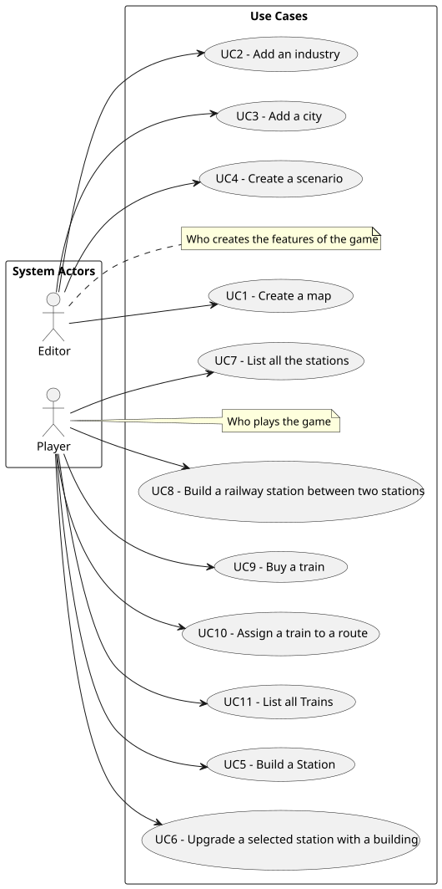

# Use Case Diagram (UCD)

**In the scope of this project, there is a direct relationship of _1 to 1_ between Use Cases (UC) and User Stories (US).**

However, be aware, this is a pedagogical simplification. On further projects and course units there may also exist _1 to N **and/or** N to 1_ relationships between UC and US.

**Insert below the Use Case Diagram in a SVG format**

**For each UC/US, it must be provided evidence of applying the main activities of the software development process (requirements, analysis, design, tests and code). Gather those evidences on a separate file for each UC/US and set up a link as suggested below.**

# Use Cases / User Stories

| UC/US | Description                                                                                              |                   
|:------|:---------------------------------------------------------------------------------------------------------|
| US001 | [Create a map](docs/sprint3/us001/01.requirements-engineering/ReadMe.md)                                 |
| US002 | [Add an industry](docs/sprint3/us002/01.requirements-engineering/Readme.md)                              |
| US003 | [Add a city](docs/sprint3/us003/01.requirements-engineering/Readme.md)                                   |
| US004 | [Create a scenario](docs/sprint3/us004/01.requirements-engineering/ReadMe.md)                            |
| US005 | [Build a Station](docs/sprint3/us005/01.requirements-engineering/Readme.md)                              |
| US006 | [Upgrade a selected station with a building](docs/sprint3/us006/01.requirements-engineering/Readme.md)   |
| US007 | [List all the stations](docs/sprint3/us007/01.requirements-engineering/Readme.md)                        |
| US008 | [Build a railway station between two stations](docs/sprint3/us008/01.requirements-engineering/Readme.md) |
| US009 | [Buy a train](docs/sprint3/us009/01.requirements-engineering/Readme.md)                                  |
| US010 | [Assign a train to a route](docs/sprint3/us010/01.requirements-engineering/Readme.md)                    |
| US011 | [List all Trains](docs/sprint3/us011/01.requirements-engineering/Readme.md)                              |
| US012 | [Create a simulator](docs/sprint3/us012/01.requirements-engineering/Readme.md)                           |

