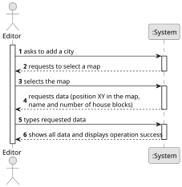

# US003—Add a city

## 1. Requirements Engineering

### 1.1. User Story Description

As an Editor, I want to add a city in a position XY of the selected map, with a name and a positive number of house blocks.

### 1.2. Customer Specifications and Clarifications

**From the specifications document:**

> The Map Editor allows you to create rectangular maps and place static elements on the map.
> Elements can be cities or industries.
>
> A city bears:
> - A name
> - A location (XY coordinates on the map)
> - A set of blocks that represent housing
>
> In the simulator's context, cities:
> - Generate and consume passengers
> - Generate and consume mail
> - Consume final products (e.g., food, textiles, cars)

**From the client clarifications:**

> **Question:** Is there a minimum or maximum number of house blocks that can be assigned?
> **Answer:** The number needs to be positive; there is no maximum, it's up to the editor to decide.
>
> **Question:** Is it possible for a city to be destroyed by a natural disaster or a war? If so, is it necessary to create a mechanism to remove the city from the map and create a new one to transfer the active elements from the first one (people, mail, ...)?
> **Answer:** A city can be removed in edit mode, but not in simulation mode.

### 1.3. Acceptance Criteria

* **AC1:** A city name cannot have special characters or digits.
* **AC2:** The house blocks can be assigned manually or automatically (randomly around the city tag position).
* **AC3:** The number of house blocks must be positive.
* **AC4:** The position XY must be within the map boundaries.
* **AC5:** The position XY must be building-free (no overlapping with other cities or industries).
* **AC6:** The city name must be unique within the map.
* **AC7:** Upon successful addition, the system must display a confirmation message.
* **AC8:** If addition fails, the system must provide a descriptive error message.

### 1.4. Found out Dependencies

* US001—"Create map": A map must exist before adding cities.

### 1.5 Input and Output Data

**Input Data:**

* **Typed Data:**
  - Position XY of the city in the map
  - Name
  - Number of house blocks
* **Selected Data:**
  - Map to add the city
    **Output Data:**
* **Confirmation of Operation:**
  - A message confirming that the operation has been completed successfully

* **Warnings or Errors (if applicable):**
  - Notifications of any input errors

**Output Data:**

*Success Response:*

* **Confirmation of Operation:**
  - A message confirming that the operation has been completed successfully
  - A message confirming that the operation has been completed successfully

* **Warnings or Errors (if applicable):**
  - Notifications of any input errors
  - Notifications of any input errors

* **Operational Feedback:**
  - A message containing all the data of the added city

### 1.6. System Sequence Diagram (SSD)

### 1.7 Other Relevant Remarks

* The system should maintain a list of valid city names to ensure uniqueness.
* City placement should consider future expansion possibilities.
* The system should track city dependencies for passenger and mail generation.
* House block placement should be considered:
  - Minimum distance between blocks
  - Maximum distance from a city center
  - Accessibility for future road/rail connections 