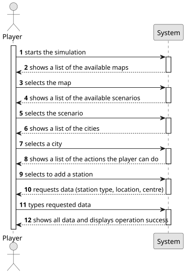

# US005—Build a Station

## 1. Requirements Engineering

### 1.1. User Story Description

As a Player, I want to build a station.

### 1.2. Customer Specifications and Clarifications

**From the specifications document:**

> A station consists of just one building, which can be upgraded
with other buildings that can increase the station’s performance, improve
train operation, facilitate train maneuvers, and increase the lifespan of
cargo stored at the station.

**From the client clarifications:**

> **Question:** Is the budget the only concern to build a station, or does the player also need to have other specific resources, like steel, etc.? Are resources included on the budget, or the budget represent only the player's monetary value?
> 
> **Answer:** just the budget in a generic currency.
> 
> **Question:** What is the input data for user story 5? Is there any input besides the type of the station?
> 
> **Answer:** Position; Station type (Terminal, Station, or Depot) and, in the case of the station, the center must be filled in. If the proposed is not accepted an alternative one must be entered.
> 
> **Question:** If overbuilding occurs, the program stops running and the game ends or simply gives an error message and asks again for the station construction place?
> 
> **Answer:** Overbuilding in the Editor is possible, the existing building is replaced for the new one; Overbuilding in the Simulator is NOT possible, the player gets a warning and games continue.
> 
> **Question:** Should the editor be allowed to create multiple stations of the same type for the same city (e.g., two Matosinhos Depots)? And, if so, should the names be different (e.g., Matosinhos Depot 1 and Matosinhos Depot 2)?
> **Answer:** yes, you can have multiple stations for a city; what really identifies a Station is the Type (depot, station, terminal) and the position, meaning, although not advisable, one can have multiple stations with the same name.
> 
> **Question:**
Should the player be able to choose specific types of stations based on certain criteria or requirements?
What criteria determine a valid location for building a station? Are there specific rules regarding proximity to other structures or geographical features?
How should players select the location on the map for their new station?
Can you clarify the specific definition of "overbuilding"? What constitutes an attempt to overbuild, and how should the system respond if the player tries to do so?
Are there any prerequisites or conditions that players must meet before they can build a station (e.g., reaching a specific level, fulfilling certain goals)?
Should players be allowed to upgrade or modify stations after they are built? If so, how would that process work?
> **Answer:**
a) when building a Station, the user can choose either a terminal, station, or depot, as far as the budget allows it
b) the cell must be empty
c) That's an UX/UI aspect, each team can decide about it
d) Overbuilding means that the selected position corresponds to a cell where some building is already located (like a house block, industry, or a station)
e) no; just budget restrictions
f) a depot can be upgraded to a station or terminal, a station can be upgraded to a terminal any time

### 1.3. Acceptance Criteria

* **AC1:** Overbuilding is not possible

### 1.4. Found out Dependencies

* There is a dependency with US001—"Create map," given that to create a station, there needs to be a map first. 

### 1.5 Input and Output Data

**Input Data:**

- Station type
- Location
- Centre

**Output Data:**

- Message of success indicating that the station has been added 

### 1.6. System Sequence Diagram (SSD)

### 1.7 Other Relevant Remarks

* 