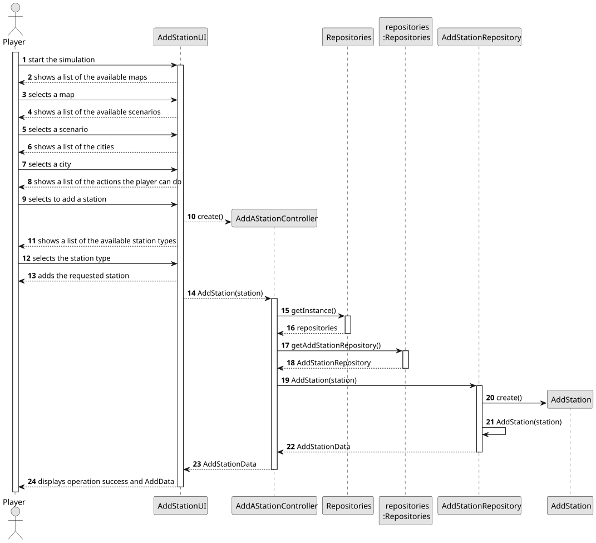
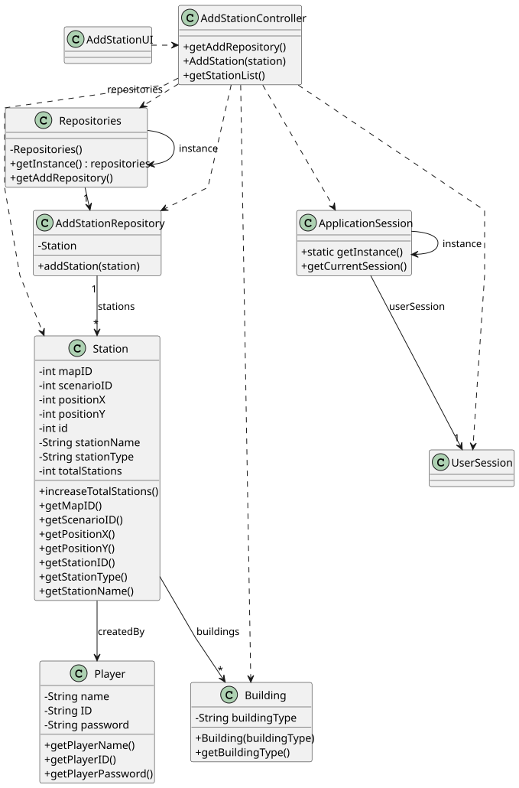

# US005 - Add a Station

## 3. Design

### 3.1. Rationale

**The rationale grounds on the SSD interactions and the identified input/output data.**

| Interaction ID | Question: Which class is responsible for... | Answer               | Justification (with patterns)                                                             |
|:---------------|:--------------------------------------------|:---------------------|:------------------------------------------------------------------------------------------|
| Step 1         | ... asking to add a station?                | PlayerUI             | **Pure Fabrication**: UI layer is responsible for managing the interaction with the user. |
| Step 2         | ... showing a list of all station types?    | AddStationUI         | **Pure Fabrication**: UI layer is responsible for showing the available stations types.   |
| Step 3         | ... asking the type of the station?         | AddStationUI         | **Pure Fabrication**: UI layer is responsible for asking the types of station.            |
| Step 4         | ... select a station type to add?           | Player               | **Role Assignment**: The player is responsible to choose a station type.                  |
| Step 5         | ... asking the X position of the station?   | AddStationUI         | **Pure Fabrication**: UI layer is responsible for asking the X position.                  |
| Step 6         | ... enter the X position?                   | Player               | **Role Assignment**: The player is responsible to enter the X position.                   |
| Step 7         | ... asking the Y position of the station?   | AddStationUI         | **Pure Fabrication**: UI layer is responsible for asking the X position.                  |
| Step 8         | ... enter the Y position?                   | Player               | **Role Assignment**: The player is responsible to enter the Y position.                   |
| Step 9         | ... verify the inserted data?               | AddStationController | **Controller**: The controller is responsible for ensuring all inputs are valid.          |
| Step 10        | ... add the station?                        | AddStationController | **Controller**: The controller is responsible for adding the station.                     |
| Step 11        | ... save the station?                       | StationRepository    | **Repository**: The repository is responsible for saving the station.                     |

### Systematization ##

According to the taken rationale, the conceptual classes promoted to software classes are: 

* Player
* Station

Other software classes (i.e. Pure Fabrication) identified: 

* PlayerUI
* AddStationUI  
* AddStationController
* StationRepository

## 3.2. Sequence Diagram (SD)

### Full Diagram

This diagram shows the full sequence of interactions between the classes involved in the realization of this user story.

## 3.3. Class Diagram (CD)

