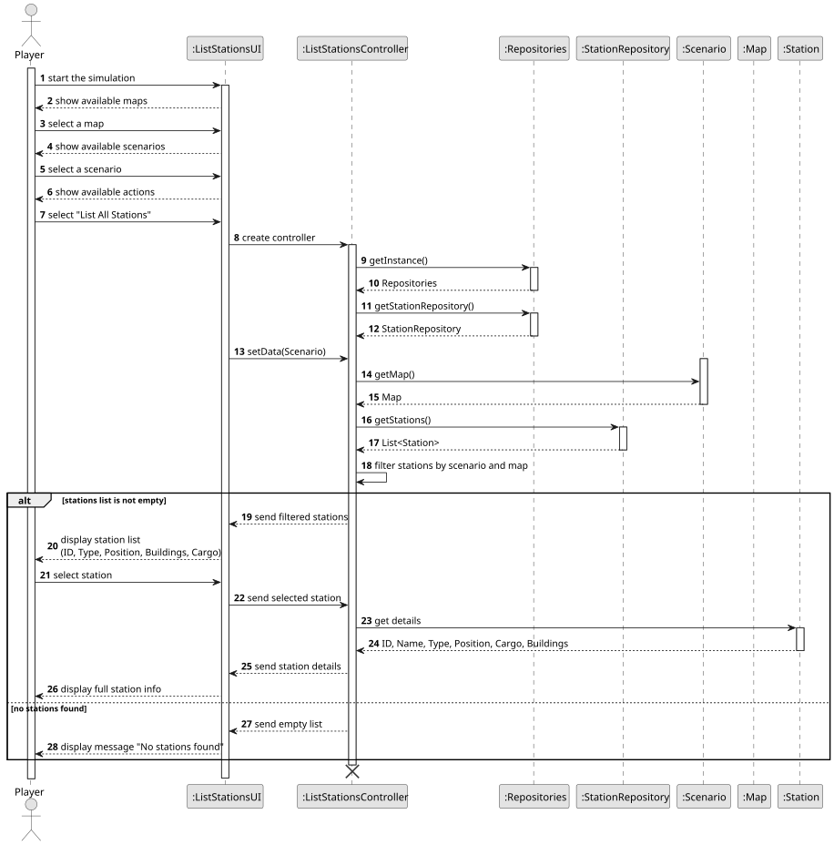
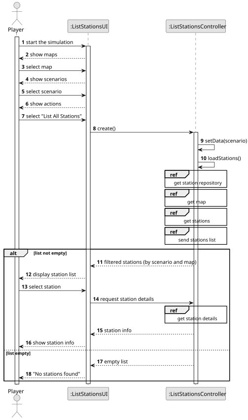
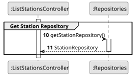
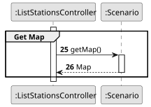
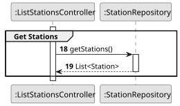
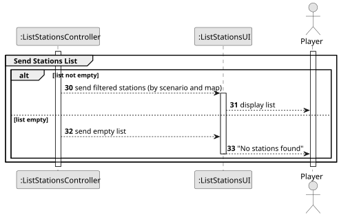
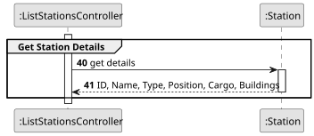

# US007 – List all the stations

## 3. Design

### 3.1. Rationale

| Interaction ID | Question: **Which class is responsible for…**                           | Answer                     | Justification (with patterns)                                                                         |
|:--------------:|:------------------------------------------------------------------------|:---------------------------|:------------------------------------------------------------------------------------------------------|
|   **Step 1**   | … initiating the request to list all stations?                          | **ListStationsUI**         | **Pure Fabrication** – the UI class manages the user interaction.                                     |
|   **Step 2**   | … coordinating the whole flow to retrieve and prepare the station data? | **ListStationsController** | **Controller** – orchestrates repository access, filters data, and sends results back to the UI.      |
|   **Step 3**   | … storing and providing access to all stations in the system?           | **StationRepository**      | **Information Expert** – holds the full list of stations and provides filtered access.                |
|   **Step 4**   | … filtering stations based on the selected map and scenario?            | **ListStationsController** | **Controller** – applies business logic related to scenario and map filtering.                        |
|   **Step 5**   | … displaying the station list (ID, Type, Position, Buildings, Cargo)?   | **ListStationsUI**         | **Pure Fabrication** – the UI is responsible for rendering information on screen.                     |
|   **Step 6**   | … showing the detailed information of a selected station?               | **ListStationsUI**         | **Pure Fabrication** – the UI reads the station’s data via getters and updates its visual components. |

---

### 3.2. Systematization

According to the taken rationale, the conceptual classes promoted to software classes are:

- `Player`
- `Station`
- `Building`

Other software classes (i.e. Pure Fabrication) identified:

- `ListStationsUI`
- `ListStationsController`
- `Repositories`
- `StationRepository`

### 3.3. Sequence Diagram (SD)

#### Full Diagram

This diagram shows the full sequence of interactions between the classes involved in the realization of this user story.

#### Split Diagrams

The following diagrams decompose the full interaction into smaller parts using **Interaction Occurrences**, providing clarity to the overall behavior.

**Get Station Repository**  

**Get Map**  

**Get Stations**  

**Send Stations List**  

**Get Station Details**  

---

### 3.4. Class Diagram (CD)

