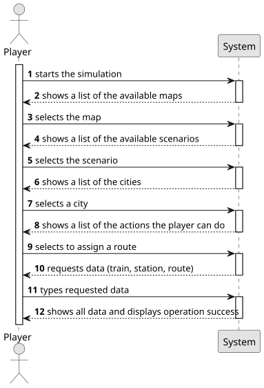

# US010 - Assign a train to a route

## 1. Requirements Engineering

### 1.1. User Story Description

As a Player, I want to assign a selected train to a route with a valid station and the respective list of cargoes to be picked up.

### 1.2. Customer Specifications and Clarifications

**From the specifications document:**

> In the simulator, the player/user acquires trains within the available budget
and can put the train into service on a specific route. A route is a list of
stations where the train passes, along which it loads (carriages) cargo at each
station.

**From the client clarifications:**

> **Question:** Can multiple cargo types be assigned to the same train?
> 
> **Answer:** yes;
> 
> **Question:** Does a route have a limit of stations that can be assigned?
> 
> **Answer:** no;
> 
> **Question:** Can a train have multiple carriages with the same type of cargo? If so, in what scenarios would that happen? 
> Does the train have a limit on the number of carriages?
> **Answer:** Yes, a train can have multiple carriages of the same cargo, accordingly to example supplied in the text. 
> I suggest 8 or 10, but it doesn't affect the functioning of the proof-of-concept.
> 
> **Question:** If a train is already following a route and a player builds a new railway line, should the simulation update the train's path to find the shortest route? (Considering that the new line might offer a faster route , or not.)
> **Answer:** yes.
> 
> 
> **Question:** Does the player have a list of routes to which he can assign trains or does he create a route and have to assign a train to it?
> **Answer:** No need to manage the routes independently of trains, each train has a route.
> 
> **Question** The user selects the list of cargoes to be picked up. Can that cargo only be delivered to the destination station, or can other stations along the route receive parts of it or even the entire cargo when the train arrives at those stations?
> **Answer:** In the Sprint 2 one can consider that the current carriages are all unloaded in the next point of the route.
> 
> **Question:** Should the route already be defined, with the player choosing from a list of valid routes (a route being a list of stations to pass through), or should the player select the stations one by one after picking the train to assign?
> **Answer:**
Each train has an associated route, and a route is a list of pairs (station - carriages to be loaded). There is no need to manage routes independently of trains.
> 
> **Question:** Does a train collect all the cargo available in a station or just the cargo required for other stations in its route? 
> When the route of a train is changed in the middle of its previous route, does it finish the route it was currently in or does it immediately start to follow the new one? If the train had cargo obtained from the previous route, what happens to it?
> **Answer:** It collects the defined in the route if available in the station otherwise it departs with the carriages empty. There is no US for changing routes.

### 1.3. Acceptance Criteria

* **AC1:** There needs to be at least two available stations
* **AC2:** There can't be a train already assigned to the selected route
* **AC3:** The train must be available (not already assigned to another route)
* **AC4:** The route must be valid (all stations must be connected by railway lines)
* **AC5:** The cargo list must be valid (each cargo must be available at its respective station)
* **AC6:** The train must have enough carriages to carry all specified cargo
* **AC7:** The system must validate that all stations in the route exist
* **AC8:** The system must ensure the route forms a continuous path
* **AC9:** The system must verify that the train has sufficient capacity for the specified cargo
* **AC10:** The system must confirm that all cargo types specified are valid
* **AC11:** The system must ensure that the first station in the route has the train's current location
* **AC12:** The system must validate that the route doesn't contain duplicate consecutive stations

### 1.4. Found out Dependencies

* There is a dependency with US005—"Build a station," given that to assign a train to a route with a valid station, there needs to be a valid station.
* There is a dependency with US008—"Build a railway line," given that to assign a train to a route, there needs to be valid railway lines.

### 1.5 Input and Output Data

**Input Data:**

- Desired train
- Desired station
- Desired route
- List of cargoes to be picked up

**Output Data:**

- Message of success indicating that the route has been assigned

### 1.6. System Sequence Diagram (SSD)

### 1.7 Other Relevant Remarks

* 