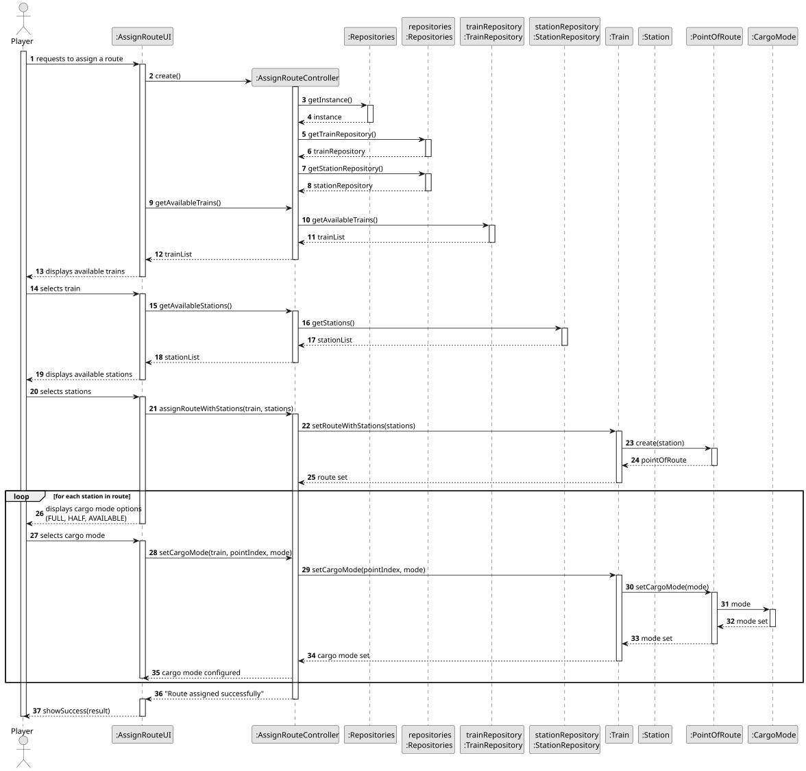
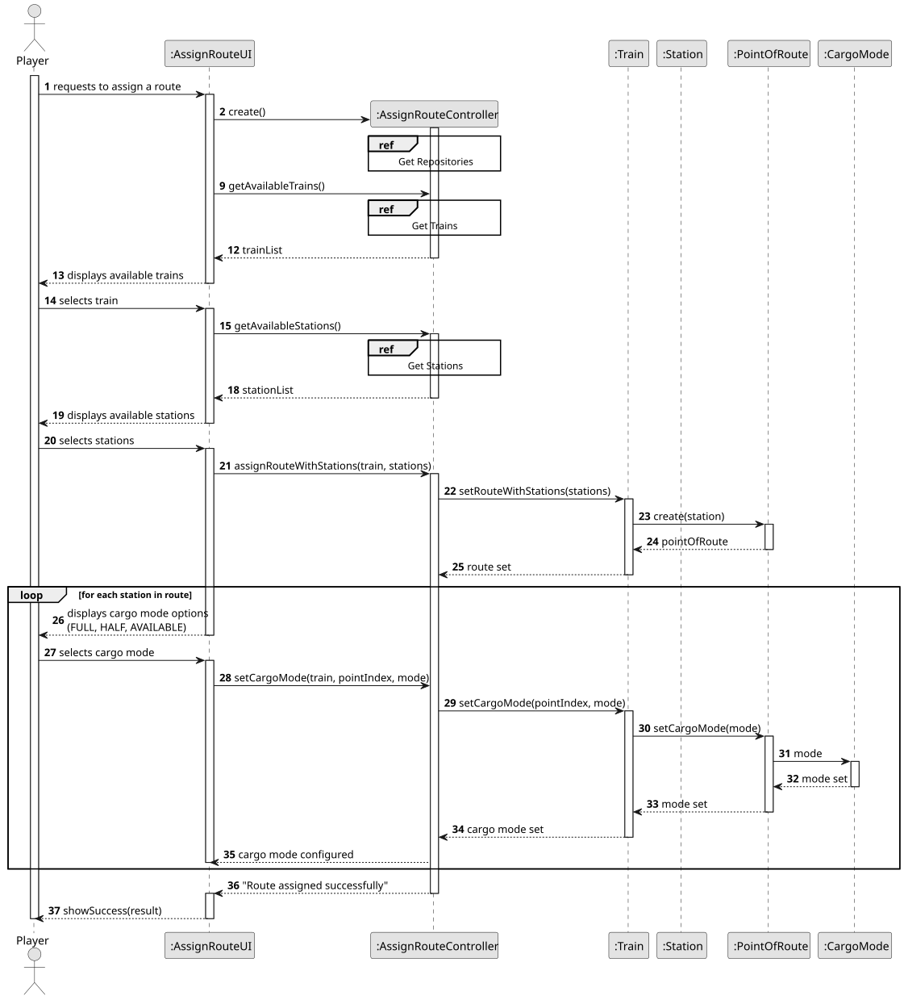
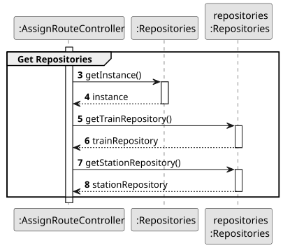
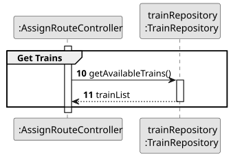
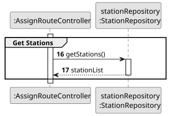
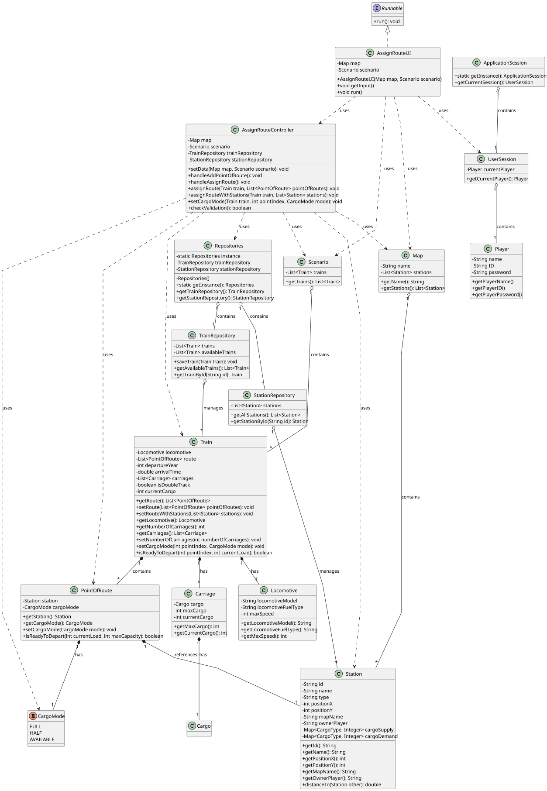

# US010 - Assign a train to a route

## 3. Design

### 3.1. Rationale

**The rationale grounds on the SSD interactions and the identified input/output data.**

| Interaction ID | Question: Which class is responsible for...      | Answer                | Justification (with patterns)                                                             |
|:---------------|:-------------------------------------------------|:----------------------|:------------------------------------------------------------------------------------------|
| Step 1         | ... asking to assign a train to a route?         | PlayerUI              | **Pure Fabrication**: UI layer is responsible for managing the interaction with the user. |
| Step 2         | ... showing a list of all available locomotives? | AssignRouteUI         | **Pure Fabrication**: UI layer is responsible for showing the available locomotives.      |
| Step 3         | ... select a locomotive to assign?               | Player                | **Role Assignment**: The player is responsible to choose a locomotive to assign.          |
| Step 4         | ... showing a list of all available stations?    | AssignRouteUI         | **Pure Fabrication**: UI layer is responsible for showing the available stations.         |
| Step 5         | ... select a stations to assign?                 | Player                | **Role Assignment**: The player is responsible to choose a list of stations to assign.    |
| Step 6         | ... save the locomotive data?                    | AssignRouteController | **Controller**: Saves the route that the locomotive must take.                            |

### Systematization ##

According to the taken rationale, the conceptual classes promoted to software classes are: 

* Player
* Locomotive

Other software classes (i.e. Pure Fabrication) identified: 

* PlayerUI
* AssignRouteUI  
* AssignRouteController

## 3.2. Sequence Diagram (SD)

### Full Diagram

This diagram shows the full sequence of interactions between the classes involved in the realization of this user story.

### Split Diagrams

The following diagram shows the same sequence of interactions between the classes involved in the realization of this user story, but it is split in partial diagrams to better illustrate the interactions between the classes.

It uses Interaction Occurrence (a.k.a. Interaction Use).

**Get Repositories**

**Get Trains**

**Get Stations**

## 3.3. Class Diagram (CD)

