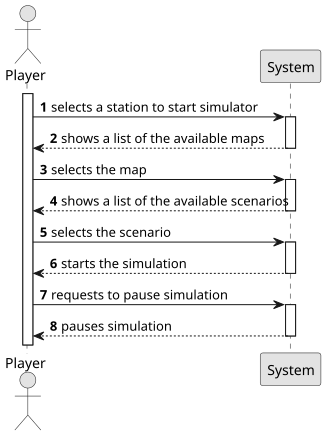

# US012—Create a simulator

## 1. Requirements Engineering

### 1.1. User Story Description

As a Product Owner, I want to create a simulator that generates cargo at current stations, automatically, considering 
the cities and industries that the railway network serves.

### 1.2. Customer Specifications and Clarifications

**From the specifications document:**

> Simulator Features:
> - Dynamic element creation
> - Play/pause functionality
> - Real-time event display:
>   * Train journey tracking
>   * Start and end events
>   * Cargo generation
>   * Network evolution

**From the client clarifications:**

> **Question:** There is a limit to cargo storage?
> 
> **Answer:** 24
> 
> **Question:** should cargo generation dynamically update as the railway network expands or changes?
> 
> **Answer:** yes; the generation is done for the industries and house blocks served by the stations present in the network.

### 1.3. Acceptance Criteria

* **AC1:** The simulator must provide start/pause functionality.
* **AC2:** The simulator must generate cargo based on connected stations.
* **AC3:** The simulator must dynamically update cargo generation when the network changes.
* **AC4:** The simulator must display real-time train movements and events.
* **AC5:** The simulator must handle network changes gracefully.
* **AC6:** The simulator must provide clear feedback on simulation status.
* **AC7:** The simulator must maintain consistent state during pause/resume.

### 1.4. Found out Dependencies

* US001—"Create map": Base map structure
* US002—"Add a station": Station creation
* US003—"Add a city": City placement
* US004—"Add an industry": Industry placement
* US005—"Build a station": Station construction
* US006—"Upgrade a station": Station upgrades
* US007—"List stations": Station information
* US008—"Build a railway line": Network connections
* US009—"Buy a locomotive": Train acquisition
* US010—"Assign a train to a route": Train operations
* US011—"List all trains": Train management

### 1.5 Input and Output Data

**Input Data:**

*Simulator:*

> Current scenario ID;
> Start, pause, resume, stop buttons;

**Output Data:**

*Simulator:*

> Simulator status (running, paused, stopped);
> Industries, locomotives, etc. stats;
> Train routes;
> Yearly financial results;

### 1.6. System Sequence Diagram (SSD)

### 1.7 Other Relevant Remarks

* The simulator should maintain efficient data structures for:
  - Event tracking
  - Cargo management
  - Train movement
  - Network state
* The simulation engine should:
  - Handle concurrent operations
  - Maintain data consistency
  - Provide real-time updates
  - Support pause/resume
* Consider implementing:
  - Event logging
  - Performance metrics
  - Network analysis
  - Cargo optimization
  - Train scheduling
* Future enhancements:
  - Multiple simulation speeds
  - Scenario saving/loading
  - Performance analytics
  - Network optimization
  - Cargo demand prediction
* 