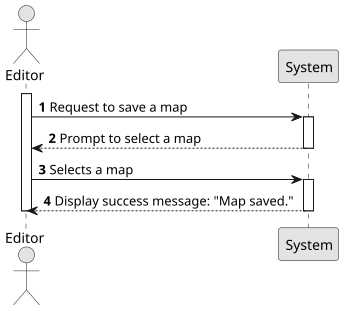

# US019 - Save Map in File 

## 1. Requirements Engineering

### 1.1. User Story Description

As an Editor, I want to Save a Map in a file for later use.

### 1.2. Customer Specifications and Clarifications

**From the specifications document:**

> The Map Editor allows you to create rectangular maps and place static elements on the map. 
Elements can be cities or industries.
> A city bears a name, a location (with XY coordinates on the map), and a set
of blocks that represent housing. In the simulator’s context, cities generate
and consume passengers and mail, but they also consume final products (e.g.,
food, textiles, cars).

**From the client clarifications:**

> **Question:** 
> 
> **Answer:** 

### 1.3. Acceptance Criteria

* **AC1:** The file must be a .csv file. 

### 1.4. Found out Dependencies

* There is a dependency with US001 - "Create map", given that to save a map, there needs to be a map first. 

### 1.5 Input and Output Data

**Input Data:**
* **Selected Data:**
  - Map to be saved
  **Output Data:**
* **Confirmation of Operation:**
    - A message confirming that the operation has been completed successfully

* **Warnings or Errors (if applicable):**
    - Notifications of any input errors

* **Operational Feedback:**
    - The file containing the details of the map.  

### 1.6. System Sequence Diagram (SSD)

### 1.7 Other Relevant Remarks

* No other relevant remarks 