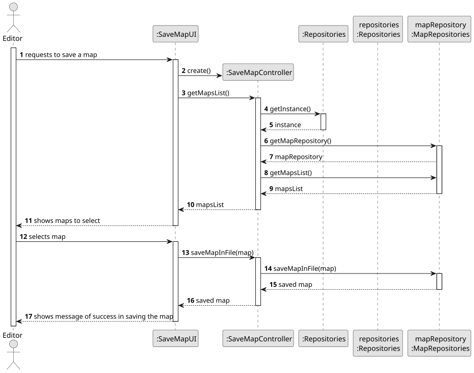
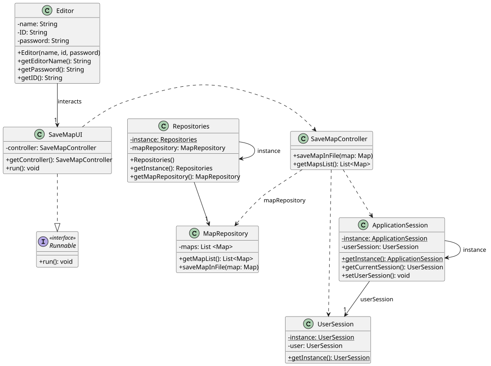

# US019 - Save Map in File

## 3. Design

### 3.1. Rationale

**The rationale grounds on the SSD interactions and the identified input/output data.**

| Interaction ID | Question: Which class is responsible for...       | Answer            | Justification (with patterns)                                                                               |
|:---------------|:--------------------------------------------------|:------------------|:------------------------------------------------------------------------------------------------------------|
| Step 1         | ...asking to save a map in file?                  | SaveMapUI         | **Pure Fabrication**: UI initiation is not a responsibility of any domain class. It fabricates interaction. |
|                | ...coordinating the US?                           | SaveMapController | **Controller**: Handles system operations initiated by the user (Editor).                                   |
|                | ...instantiating the class that handles the UI?   | SaveMapUI         | **Pure Fabrication**: No domain object is responsible for UI instantiation.                                 |
| Step 2         | ...retrieving the list of maps?                   | SaveMapController | **Controller**: Responsible for obtaining data from repositories.                                           |
| Step 3         | ...providing the maps data?                       | MapRepository     | **Information Expert**: Repository holds the maps data and is responsible for providing it.                 |
| Step 4         | ...showing maps to select?                        | SaveMapUI         | **Pure Fabrication**: UI class presents data to the user.                                                   |
| Step 5         | ...selecting a map?                               | Editor            | **Role Assignment**: The actor (Editor) selects the map to save.                                            |
| Step 6         | ...saving the map to a file?                      | MapRepository     | **Information Expert**: Repository has the knowledge to save maps to files.                                 |
| Step 7         | ...showing the operation success?                 | SaveMapUI         | **Pure Fabrication**: UI class presents success messages to the user.                                       |
| Step 8         | ...coordinating between UI and Domain for flow?   | SaveMapController | **Controller**: Central coordinator for user-system interaction.                                            |

### Systematization ##

According to the taken rationale, the conceptual classes promoted to software classes are:

* Map
* MapRepository
* Editor

Other software classes (i.e., Pure Fabrication) identified:

* SaveMapUI
* SaveMapController
* Repositories
* ApplicationSession
* UserSession

## 3.2. Sequence Diagram (SD)

## 3.3. Class Diagram (CD)

