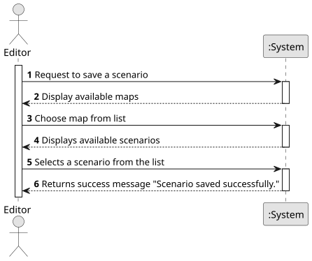

# US021 - Save a Scenario in File 

## 1. Requirements Engineering

### 1.1. User Story Description

As an Editor, I want to Save a Scenario in a file for later use.

### 1.2. Customer Specifications and Clarifications

**From the specifications document:**

> The Scenario Editor must allow the user to define the restrictions and
conditions for using a given map, namely:
• Time Restrictions - the period in which the simulation will take place;
• Technological Restrictions - for example, which locomotives or industries are available in the scenario;
• Historical Restrictions - historical events that make sense in the scenario and change the operating conditions of
the simulator. For instance, a war increases the steel demand, and a vaccination campaign or a schooling program
encourages mail and/or passenger traffic. In this context, the goods that the Ports import and export are also defined.

**From the client clarifications:**

> **Question:**
> 
> **Answer:** 

### 1.3. Acceptance Criteria

* **AC1:** The file must be a .csv file.

### 1.4. Found out Dependencies

* There is a dependency with US004 - "Create a Scenario", given that to save a scenario, there needs to be a scenario first. 

### 1.5 Input and Output Data

**Input Data:**
* **Selected Data:**
    - Scenario to be saved
**Output Data:**
* **Confirmation of Operation:**
    - A message confirming that the operation has been completed successfully

* **Warnings or Errors (if applicable):**
    - Notifications of any input errors

* **Operational Feedback:**
    - The file containing the details of the scenario.

### 1.6. System Sequence Diagram (SSD)

### 1.7 Other Relevant Remarks

* No other relevant remarks 