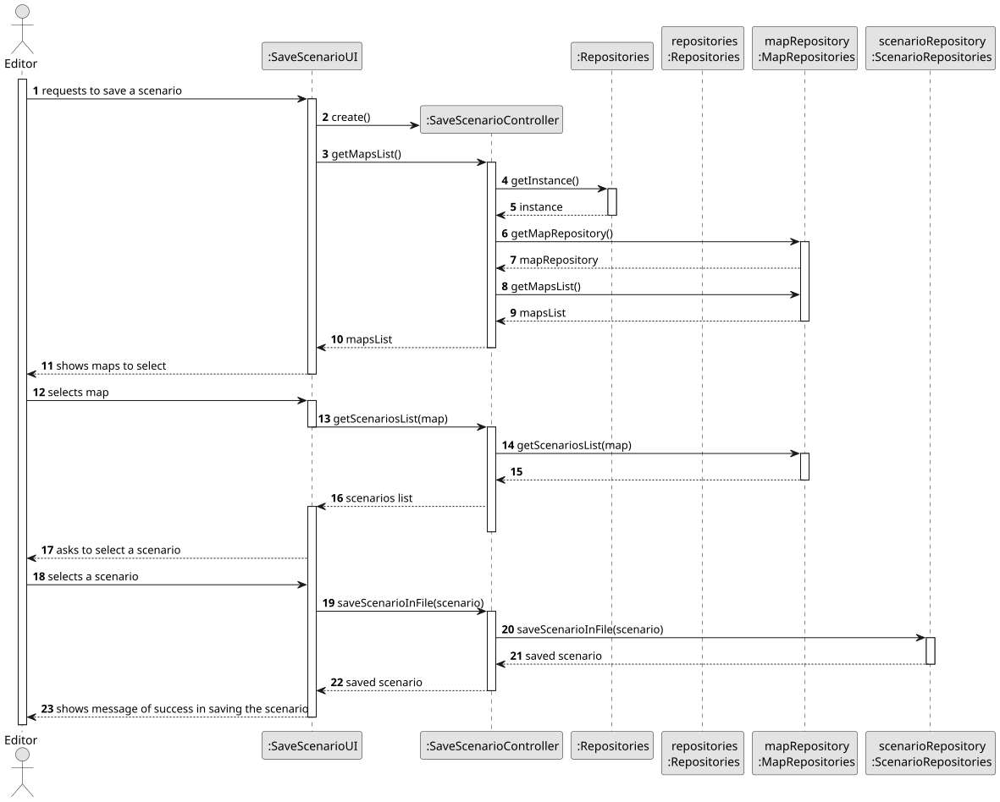
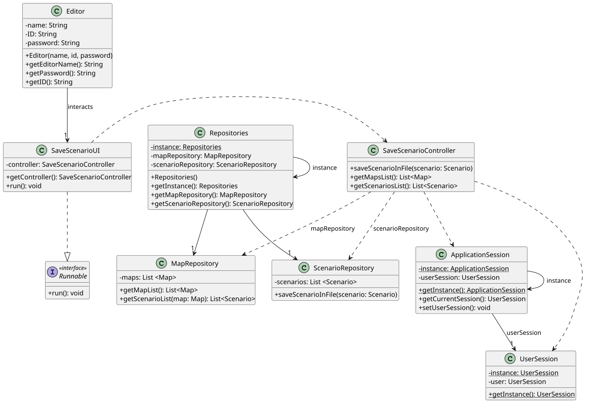

# US021 - Save Scenario in File

## 3. Design

### 3.1. Rationale

**The rationale grounds on the SSD interactions and the identified input/output data.**

| Interaction ID | Question: Which class is responsible for...     | Answer                 | Justification (with patterns)                                                                               |
|:---------------|:------------------------------------------------|:-----------------------|:------------------------------------------------------------------------------------------------------------|
| Step 1         | ...asking to save a scenario in file?           | SaveScenarioUI         | **Pure Fabrication**: UI initiation is not a responsibility of any domain class. It fabricates interaction. |
|                | ...coordinating the US?                         | SaveScenarioController | **Controller**: Handles system operations initiated by the user (Editor).                                   |
|                | ...instantiating the class that handles the UI? | SaveScenarioUI         | **Pure Fabrication**: No domain object is responsible for UI instantiation.                                 |
| Step 2         | ...retrieving the list of maps?                 | SaveScenarioController | **Controller**: Responsible for obtaining data from repositories.                                           |
| Step 3         | ...providing the maps data?                     | MapRepository          | **Information Expert**: Repository holds the maps data and is responsible for providing it.                 |
| Step 4         | ...showing maps to select?                      | SaveScenarioUI         | **Pure Fabrication**: UI class presents data to the user.                                                   |
| Step 5         | ...selecting a map?                             | Editor                 | **Role Assignment**: The actor (Editor) selects the map.                                                    |
| Step 6         | ...retrieving scenarios for the selected map?   | SaveScenarioController | **Controller**: Responsible for obtaining scenarios from repositories.                                      |
| Step 7         | ...providing the scenarios data?                | MapRepository          | **Information Expert**: Repository has the knowledge about scenarios for a map.                             |
| Step 8         | ...showing scenarios to select?                 | SaveScenarioUI         | **Pure Fabrication**: UI class presents data to the user.                                                   |
| Step 9         | ...selecting a scenario?                        | Editor                 | **Role Assignment**: The actor (Editor) selects the scenario to save.                                       |
| Step 10        | ...saving the scenario to a file?               | ScenarioRepository     | **Information Expert**: Repository has the knowledge to save scenarios to files.                            |
| Step 11        | ...showing the operation success?               | SaveScenarioUI         | **Pure Fabrication**: UI class presents success messages to the user.                                       |

### Systematization ##

According to the taken rationale, the conceptual classes promoted to software classes are:

* Map
* Scenario
* MapRepository
* ScenarioRepository
* Editor

Other software classes (i.e., Pure Fabrication) identified:

* SaveScenarioUI
* SaveScenarioController
* Repositories
* ApplicationSession
* UserSession

## 3.2. Sequence Diagram (SD)

## 3.3. Class Diagram (CD)

