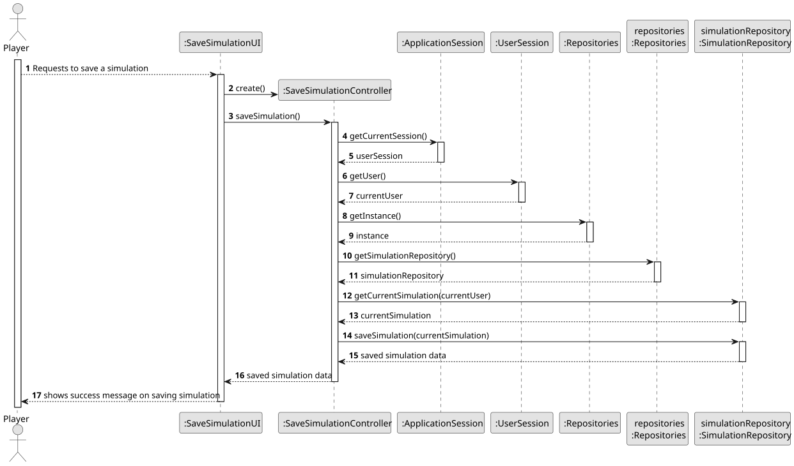
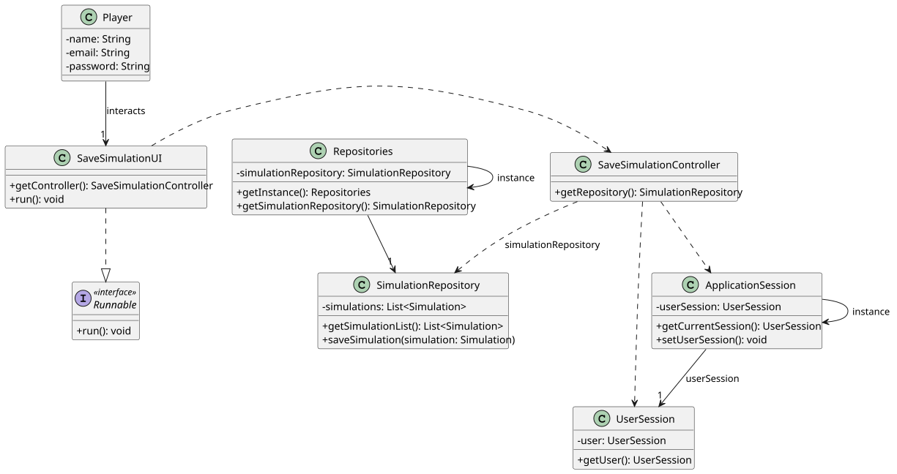

# US023 - Save Simulation in File

## 3. Design

### 3.1. Rationale

**The rationale grounds on the SSD interactions and the identified input/output data.**

| Interaction ID | Question: Which class is responsible for...      | Answer                   | Justification (with patterns)                                                                               |
|:---------------|:-------------------------------------------------|:-------------------------|:------------------------------------------------------------------------------------------------------------|
| Step 1         | ... asking to save a simulation in file?         | SaveSimulationUI         | **Pure Fabrication**: UI initiation is not a responsibility of any domain class. It fabricates interaction. |
|                | ... coordinating the US?                         | SaveSimulationController | **Controller**: Handles system operations initiated by the user (Player).                                   |
|                | ... instantiating the class that handles the UI? | SaveSimulationUI         | **Pure Fabrication**: No domain object is responsible for UI instantiation.                                 |
| Step 2         | ... saving the simulation to a file?             | SimulationRepository     | **Information Expert**: Repository has the knowledge to save simulations to files.                          |
| Step 3         | ... showing the operation success?               | SaveSimulationUI         | **Pure Fabrication**: UI class presents success messages to the user.                                       |
| Step 4         | ... coordinating between UI and Domain for flow? | SaveSimulationController | **Controller**: Central coordinator for user-system interaction.                                            |

### Systematization ##

According to the taken rationale, the conceptual classes promoted to software classes are:

* Simulation
* SimulationRepository
* Player

Other software classes (i.e. Pure Fabrication) identified:

* SaveSimulationUI
* SaveSimulationController
* Repositories
* ApplicationSession
* UserSession

## 3.2. Sequence Diagram (SD)

## 3.3. Class Diagram (CD)

