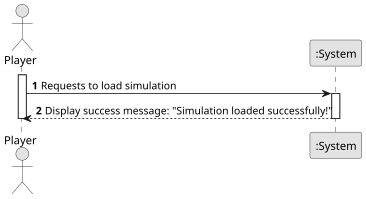

# US024 - Load Simulation from File

## 1. Requirements Engineering

### 1.1. User Story Description

As a Player, I want to Load a Simulation (Game) from a file previously saved.

### 1.2. Customer Specifications and Clarifications

**From the specifications document:**

> The simulator will enable the manager (or, from the playful perspective, the player) to create a railway network
> composed of stations that serve cities and industries, lines connecting those stations, and trains that transport
> cargo between stations, according to a route defined by the manager. It is crucial to highlight that cities and
> industries only generate or transform cargo if they have a station; when the cargo is generated, it is then
> available to be collected at the station.
>
> In the simulator, the player/user acquires trains within the available budget and can put the train into service
> on a specific route.
>
> In addition to creating the dynamic elements already described, the player/user can play or pause the simulator.
> During the simulator’s operation, the evolution of events should be displayed, namely the trains’ journeys.

**From the client clarifications:**

> **Question:**
>
> **Answer:**

### 1.3. Acceptance Criteria

### 1.4. Found out Dependencies

* There is a dependency with US012 - "Create a Simulator", given that to save a simulation there needs to be a
  simulator responsible to run the simulations.

### 1.5 Input and Output Data

**Input Data:**
* **File Path or File Name:**
*
* **Confirmation to Load:**
    - Confirmation from user that he wants to load and replace the current progress of the game.

**Output Data:**

* **Load Simulation Object:**
    - The complete progress of the game loaded from the file.

* **Success Message:**
    - Success message that the simulation was loaded successfully.

* **Error Message:**
    - Error message in case file doesn't exist, or is invalid.

### 1.6. System Sequence Diagram (SSD)

### 1.7 Other Relevant Remarks

* No other relevant remarks 