#   
USER MANUAL

 

### 
Oriented by:

#### 
Cidália Neves

### Created by:

#### Susana Loureiro
#### 

 
 
 
 
 
 

## Table of Content

1. [Introduction](#introduction)

2. [System Overview](#system-overview)

3. [System Requirements](#system-requirements)

4. [Features](#features)
   1. [Authentication](#authentication)
      1. [Login](#login)
      2. [Registration](#registration)
   2. [Editor Role](#editor-role)
      1. [Create Map](#create-map)
      2. [Display Map List](#display-map-list)
      3. [Create Scenario](#create-scenario)
      4. [Add City](#add-city)
      5. [Add Industry](#add-industry)
   3. [Player Role](#player-role)
      1. [Build Station](#build-station)
      2. [Upgrade Station](#upgrade-station)
      3. [Check Station Details](#check-station-details)
      4. [Buy Locomotive](#buy-locomotive)
      5. [Assign Train to Route](#assign-train-to-route)

5. [Troubleshooting](#troubleshooting)

6. [Frequently Asked Questions](#frequently-asked-questions)

7. [Glossary](#glossary)

# Introduction

This guide is designed to help users effectively use the Railway Network Simulation System. With clear and simple guidelines, anyone will be able to understand and operate this product. The guide contains guidelines, pictures, and diagrams designed to help the user follow the steps and be able to perform all the intended tasks without needing help from the development team.

The product described in this user manual is an application used to simulate the operation of railway networks. The application contains all the tools needed to create maps, build railway networks, manage trains, and simulate railway operations. It helps both editors who create maps and scenarios, and players who manage railway networks.

This user manual has been provided to the user with the purpose of demonstrating how to use the Railway Network Simulation System.

# System Overview

The Railway Network Simulation System is a comprehensive platform designed to simulate the operation of railway networks. The system consists of two main components:

1. **Map and Scenario Editor**: This component allows users to create maps, place cities and industries, and define scenarios with time, technological, and historical restrictions.

2. **Simulator**: This component enables users to build railway networks by placing stations, connecting them with railway lines, buying trains, and assigning them to routes.

The system includes the following key domain concepts:

* **Map Elements**: Maps, Cities, Industry types (Primary, Transforming, Mixed)
* **Railway Components**: Station types (Depot, Regular, Terminal), Railway Lines
* **Train Components**: Trains, Locomotives, Carriages
* **Operations**: Routes, Cargo management, Simulator

The system allows users to:
* Create maps and place cities and industries
* Define scenarios with specific restrictions
* Build railway networks by placing stations and connecting them with railway lines
* Buy locomotives and assign them to routes
* Simulate railway operations

# System Requirements

To run the Railway Network Simulation System, your computer must meet the following requirements:

* Operating System: Windows, macOS, or Linux
* Java Runtime Environment (JRE) 11 or higher
* Minimum 4GB RAM
* 500MB of free disk space
* Screen resolution of 1280x720 or higher

# Features

## Authentication

### Login

When you start the application, you will see the main menu with options to login, create a user, or view the development team information.

Step 1: Select "Login" from the main menu.

Step 2: Enter your email and password according to the syntax notes.

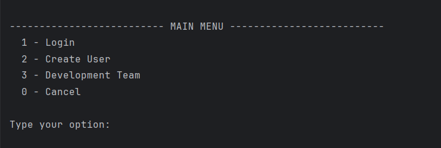
Image 1: Login screen

### Registration

If you don't have an account yet, you can create one by following these steps:

Step 1: Select "Create User" from the main menu.

Step 2: Enter your name, email, and password according to the syntax notes.

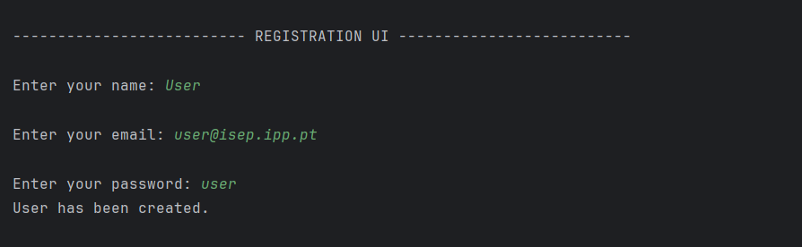
Image 2: Registration screen

#### Syntax Notes:
+ Name: Should contain at least 8 characters
+ Email: Should contain an e-mail prefix, before the "@" symbol, and e-mail domain, after the "@" symbol
+ Password: Should contain seven alphanumeric characters, including three capital letters and two digits

## Editor Role

After logging in as an Editor, you will have access to the Editor Menu with the following options:

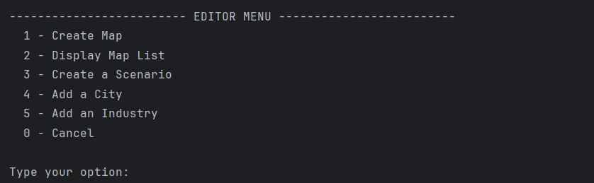
Image 3: Editor Menu

### Create Map

This feature allows you to create a new map with specific dimensions.

Step 1: Select "Create Map" from the Editor Menu.

Step 2: Enter the name of the map.

Step 3: Enter the width of the map (positive integer up to 256).

Step 4: Enter the height of the map (positive integer up to 256).

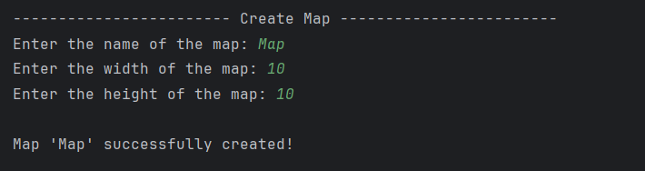
Image 4: Create Map screen

### Display Map List

This feature allows you to view all the maps that have been created.

Step 1: Select "Display Map List" from the Editor Menu.

Step 2: The system will display a list of all available maps with their names and dimensions.

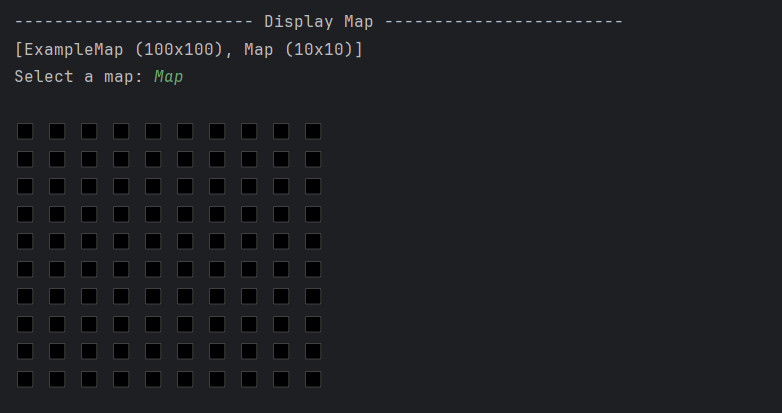
Image 5: Display Map List screen

### Create Scenario

This feature allows you to create a scenario for a selected map, defining various restrictions.

Step 1: Select "Create a Scenario" from the Editor Menu.

Step 2: Select a map from the list of available maps.

Step 3: Define the behavior of ports, including which cargoes they import/export and/or transform.

Step 4: Define the available locomotion types (steam, diesel, and/or electric).

Step 5: Define the factors that alter the generation frequency of generating industries.

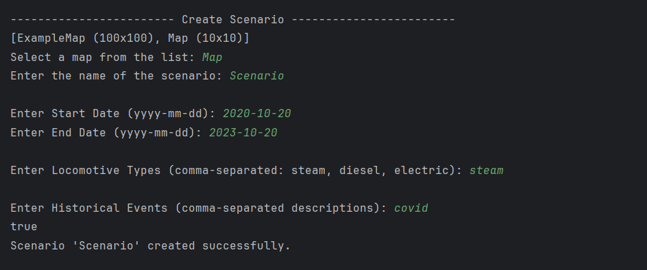
Image 6: Create Scenario screen

### Add City

This feature allows you to add a city to a selected map.

Step 1: Select "Add a City" from the Editor Menu.

Step 2: Select a map from the list of available maps.

Step 3: Enter the name of the city (cannot contain special characters or digits).

Step 4: Enter the X and Y coordinates for the city's position on the map.

Step 5: Enter the number of house blocks for the city, or select to generate them automatically.

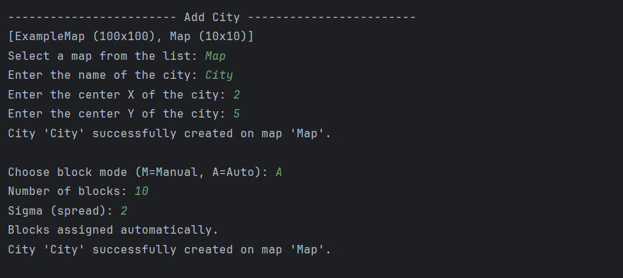
Image 7: Add City screen

### Add Industry

This feature allows you to add an industry to a selected map.

Step 1: Select "Add an Industry" from the Editor Menu.

Step 2: Select a map from the list of available maps.

Step 3: Select the type of industry from the available options.

Step 4: Enter the X and Y coordinates for the industry's position on the map.

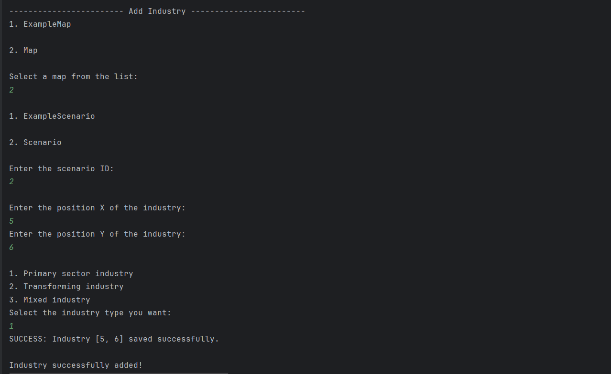
Image 8: Add Industry screen

## Player Role

After logging in as a Player, you will have access to the Player Menu with the following options:

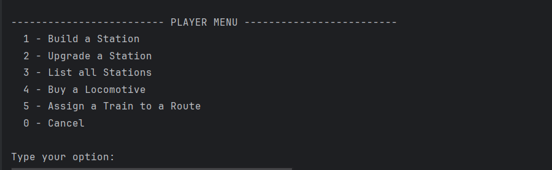
Image 9: Player Menu

### Build Station

This feature allows you to build a station on the current map.

Step 1: Select "Build a Station" from the Player Menu.

Step 2: Select the type of station (Depot, Station, or Terminal).

Step 3: Enter the X and Y coordinates for the station's position on the map.

Step 4: If building a Station, select the center position (NE, SE, NW, SW).

Step 5: The system will propose a name for the station based on the closest city.

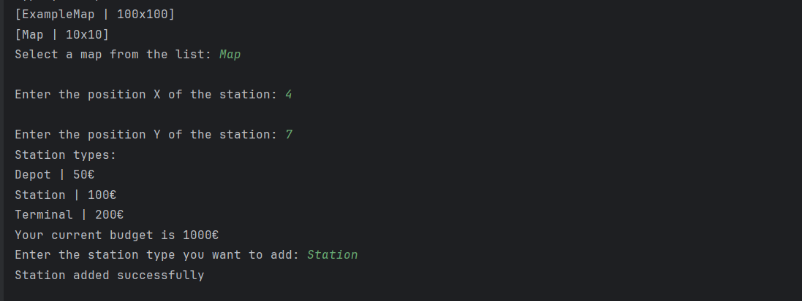
Image 10: Build Station screen

### Upgrade Station

This feature allows you to upgrade a selected station with a building.

Step 1: Select "Upgrade a Station" from the Player Menu.

Step 2: Select a station from the list of available stations.

Step 3: Select a building to add to the station from the list of available buildings.

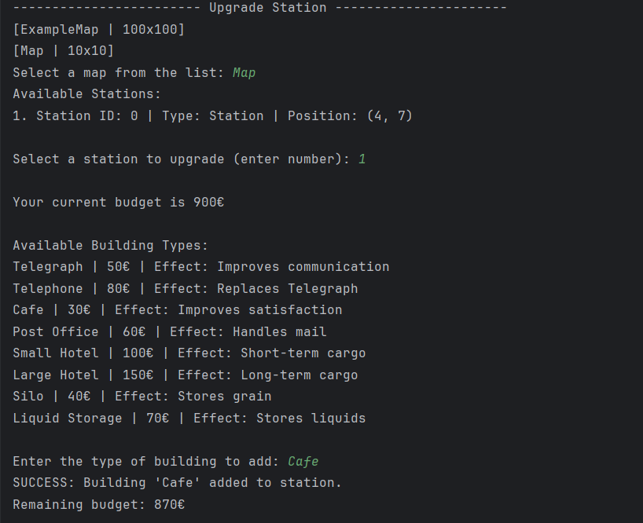
Image 11: Upgrade Station screen

### Check Station Details

This feature allows you to view the details of a selected station.

Step 1: Select "Check Station Details" from the Player Menu.

Step 2: Select a station from the list of available stations.

Step 3: The system will display the station's details, including its buildings and the demand/supply cargoes.

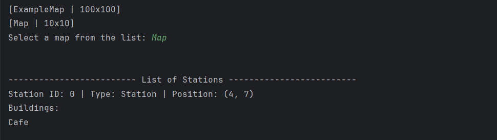
Image 12: Check Station Details screen

### Buy Locomotive

This feature allows you to buy a locomotive.

Step 1: Select "Buy a Locomotive" from the Player Menu.

Step 2: Select a locomotive from the list of available locomotives for the current scenario.

Step 3: The system will display the locomotive's details, including its model, fuel type, speed, and price.

Step 4: Confirm the purchase.

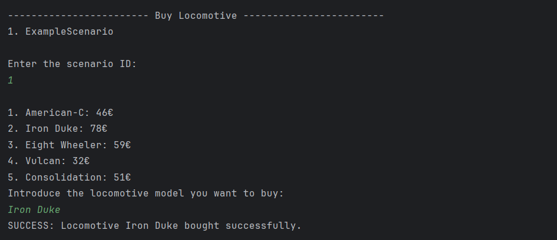
Image 13: Buy Locomotive screen

### Assign Train to Route

This feature allows you to assign a train to a route with specific stations and cargoes.

Step 1: Select "Assign a Train to a Route" from the Player Menu.

Step 2: Select a train from the list of available trains.

Step 3: Select the stations that will be part of the route.

Step 4: For each station, select the cargoes to be picked up.

Step 5: Confirm the route assignment.

<!--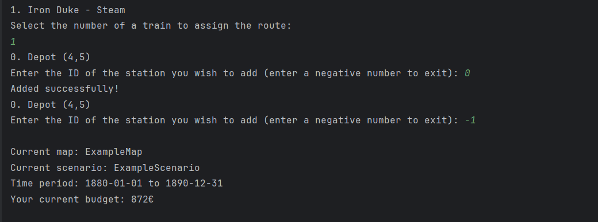-->
Image 14: Assign Train to Route screen

# Troubleshooting

This section provides solutions to common problems that users may encounter while using the Railway Network Simulation System.

## Problem: Unable to login

**Solution**:
- Ensure that you are entering the correct email and password.
- Check if your password meets the requirements: seven alphanumeric characters, including three capital letters and two digits.
- If you have forgotten your password, you will need to create a new user.

## Problem: Cannot create a map

**Solution**:
- Ensure that the map name is unique and valid.
- Make sure the width and height values are positive integers not exceeding 256.

## Problem: Cannot build a station

**Solution**:
- Ensure that the position is within the map boundaries.
- Check that there is no overlap with existing stations or other elements.
- Verify that you have sufficient budget to build the station.

## Problem: Cannot buy a locomotive

**Solution**:
- Ensure that you have sufficient budget to purchase the locomotive.
- Check that the locomotive is available in the current scenario.

# Frequently Asked Questions

**Q: How do I create a new map?**
A: From the Editor Menu, select "Create Map" and follow the prompts to enter the map name, width, and height.

**Q: How do I add a city to a map?**
A: From the Editor Menu, select "Add a City", choose a map, enter the city name and position, and specify the number of house blocks.

**Q: How do I build a railway network?**
A: As a Player, you can build stations, connect them with railway lines, buy locomotives, and assign them to routes.

**Q: How do I simulate railway operations?**
A: After setting up your railway network, the simulator will automatically generate cargoes at stations based on the cities and industries they serve.

**Q: Can I upgrade my stations?**
A: Yes, you can upgrade stations by adding buildings such as telegraph, café, customs, post office, hotel, silo, or liquid storage.

# Glossary

| **Term**                       | **Description**                                                     |
|--------------------------------|---------------------------------------------------------------------|
| **Application**                | A software program designed to perform specific tasks for the user. |
| **Budget**                     | Financial plans for expected revenues and expenditures over time.   |
| **Cargo**                      | Goods or materials transported by trains.                           |
| **Cargo Demand**               | The amount of cargo a station needs to receive.                     |
| **Cargo Supply**               | The amount of cargo a station can provide.                          |
| **Carriages**                  | Parts of a train that carry passengers or cargo.                    |
| **City**                       | A populated area that can be placed on the map.                     |
| **Diesel**                     | A locomotive powered by a diesel engine.                            |
| **Economic Radius**            | The area around a station that supplies or demands cargo.           |
| **Electric**                   | A locomotive powered by electricity, requiring electrified tracks.  |
| **Historical Restrictions**    | Scenario events that change how the simulation operates.            |
| **Industry**                   | A static element that produces or transforms resources.             |
| **Locomotive**                 | The engine part of a train that moves the train.                    |
| **Locomotive Types**           | Steam, diesel, and electric locomotives.                            |
| **Map**                        | The playable area with cities, industries, and stations.            |
| **Mixed Industries**           | Industries that combine different sectors.                          |
| **Player**                     | The user interacting with the simulation.                           |
| **Primary Sector Industries**  | Industries generating natural resources like mines and farms.       |
| **Product Owner**              | The person responsible for defining features and priorities.        |
| **Railway**                    | Tracks, stations, and trains used for transport.                    |
| **Route**                      | The path a train follows.                                           |
| **Simulator**                  | A software that replicates real-world systems.                      |
| **Simulator Operation**        | Interacting with the simulator under various conditions.            |
| **Station**                    | A place where trains stop to load or unload.                        |
| **Steam**                      | A locomotive powered by steam.                                      |
| **Technological Restrictions** | Restrictions based on available train technology.                   |
| **Time Restrictions**          | Time periods that define the simulation era.                        |
| **Track**                      | The metal rails trains run on.                                      |
| **Train**                      | A combination of locomotives and carriages.                         |
| **Train Simulator**            | A simulator focused on train operations.                            |
| **Transforming Industries**    | Industries that turn raw materials into products.                   |

