#   
USER MANUAL

 

### 
Oriented by:

#### 
Cidália Neves

### Created by:

#### Susana Loureiro
#### Iva Silva
#### João Ferreira 
#### Rafael Capão 
#### José Cardoso

 
 
 
 
 
 

## Table of Content

1. [Introduction](#introduction)

2. [System Overview](#system-overview)

3. [System Requirements](#system-requirements)

4. [Features](#features)
   1. [Authentication](#authentication)
      1. [Login](#login)
      2. [Registration](#registration)
   2. [Editor Role](#editor-role)
      1. [Choose Map](#choose-map)
      2. [Create Map](#create-map)
      3. [Display Map List](#display-map-list)
      4. [Create Scenario](#create-scenario)
      5. [Add City](#add-city)
      6. [Add Industry](#add-industry)
      7. [Load Map from File](#load-map-from-file)
      8. [Save Map to File](#save-map-to-file)
      9. [Save Scenario to File](#save-scenario-to-file)
      10. [Load Scenario from File](#load-scenario-from-file)
   3. [Player Role](#player-role)
      1. [Build Station](#build-station)
      2. [Upgrade Station](#upgrade-station)
      3. [Check Station Details](#check-station-details)
      4. [Buy Locomotive](#buy-locomotive)
      5. [Assign Train to Route](#assign-train-to-route)
      6. [Start a Simulation](#start-simulation)

5. [Troubleshooting](#troubleshooting)

6. [Frequently Asked Questions](#frequently-asked-questions)

7. [Glossary](#glossary)

# Introduction

This guide is designed to help users effectively use the Railway Network Simulation System. With clear and simple guidelines, anyone will be able to understand and operate this product. The guide contains guidelines, pictures, and diagrams designed to help the user follow the steps and be able to perform all the intended tasks without needing help from the development team.

The product described in this user manual is an application used to simulate the operation of railway networks. The application contains all the tools needed to create maps, build railway networks, manage trains, and simulate railway operations. It helps both editors who create maps and scenarios, and players who manage railway networks.

This user manual has been provided to the user with the purpose of demonstrating how to use the Railway Network Simulation System.

# System Overview

The Railway Network Simulation System is a comprehensive platform designed to simulate the operation of railway networks. The system consists of two main components:

1. **Map and Scenario Editor**: This component allows users to create maps, place cities and industries, and define scenarios with time, technological, and historical restrictions.

2. **Simulator**: This component enables users to build railway networks by placing stations, connecting them with railway lines, buying trains, and assigning them to routes.

The system includes the following key domain concepts:

* **Map Elements**: Maps, Cities, Industry types (Primary, Transforming, Mixed)
* **Railway Components**: Station types (Depot, Regular, Terminal), Railway Lines
* **Train Components**: Trains, Locomotives, Carriages
* **Operations**: Routes, Cargo management, Simulator

The system allows users to:
* Create maps and place cities and industries
* Define scenarios with specific restrictions
* Build railway networks by placing stations and connecting them with railway lines
* Buy locomotives and assign them to routes
* Simulate railway operations

# System Requirements

To run the Railway Network Simulation System, your computer must meet the following requirements:

* Operating System: Windows, macOS, or Linux
* Java Runtime Environment (JRE) 11 or higher
* Minimum 4GB RAM
* 500MB of free disk space
* Screen resolution of 1280x720 or higher

# Features

## Authentication

### Login

When you start the graphical application, you will see the main menu with options to login, create a user, or view the development team information.

Step 1: Select "Login" from the main menu.

Step 2: Enter your email and password according to the syntax notes.

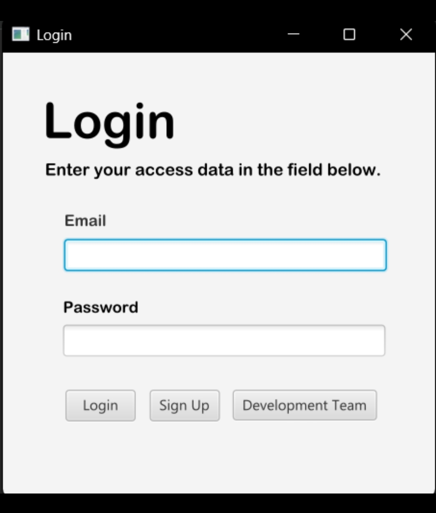
Image 1: Login screen

### Registration

If you don't have an account yet, you can create one by following these steps:

Step 1: Select "Sign Up" from the main menu.

Step 2: Enter your name, email, and password according to the syntax notes.

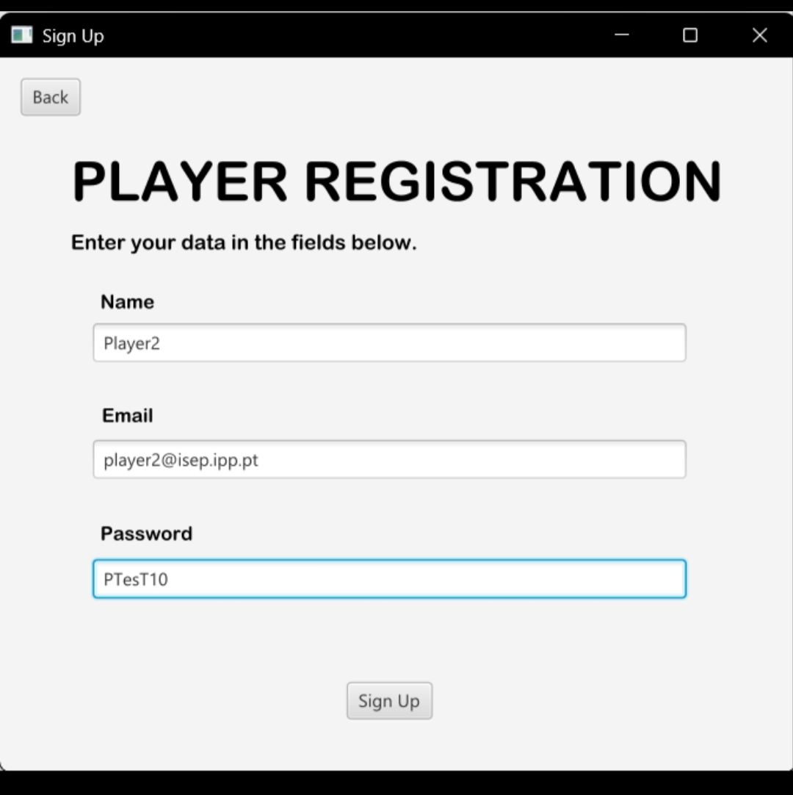
Image 2: Registration screen

#### Syntax Notes:
+ Name: Should contain at least 8 characters
+ Email: Should contain an e-mail prefix, before the "@" symbol, and e-mail domain, after the "@" symbol
+ Password: Should contain seven alphanumeric characters, including three capital letters and two digits

## Editor Role

After logging in as an Editor, you will first need to choose a map to work with. This map will be used throughout your entire session.

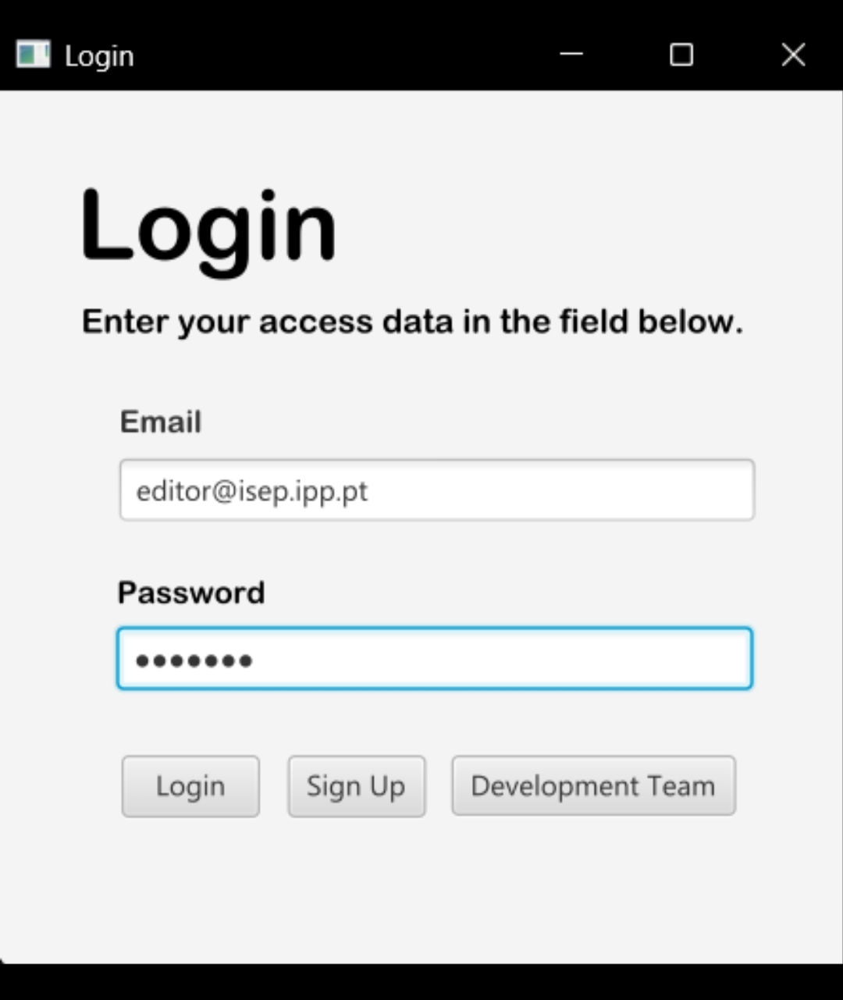
Image 3: Editor Login screen

### Choose Map

When you log in as an Editor, you must first select a map to work with. You can either choose an existing map or create a new one.

Step 1: Select a map from the list or create a new one.

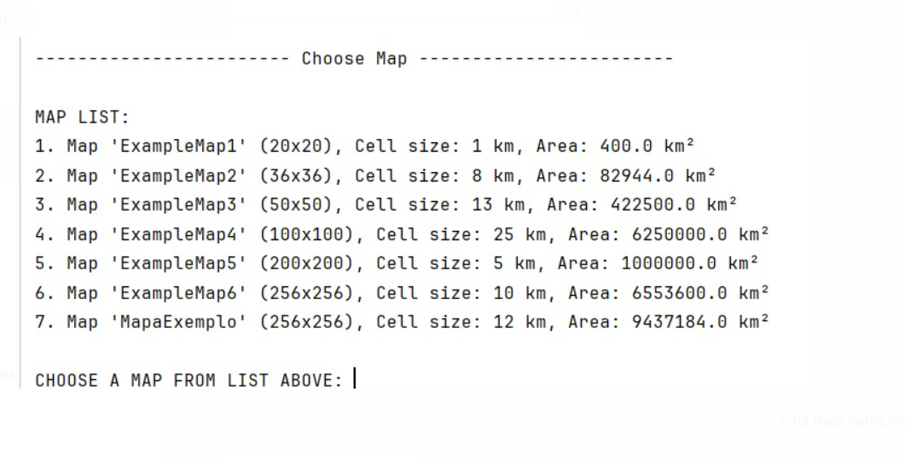
Image: Choose Map screen

After selecting a map, you will have access to the Editor Menu for Maps with various options for that specific map:

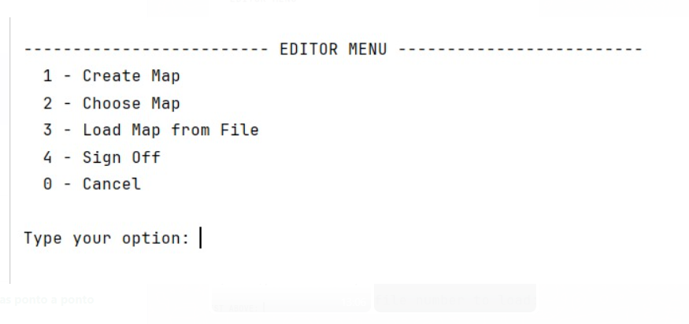
Image: Editor Menu for Maps

### Create Map

This feature allows you to create a new map with specific dimensions.

Step 1: Select "Create Map" when prompted to choose a map.

Step 2: Enter the name of the map.

Step 3: Enter the width of the map (positive integer up to 256).

Step 4: Enter the height of the map (positive integer up to 256).

Step 5: Enter the size of each cell block in kilometers. 
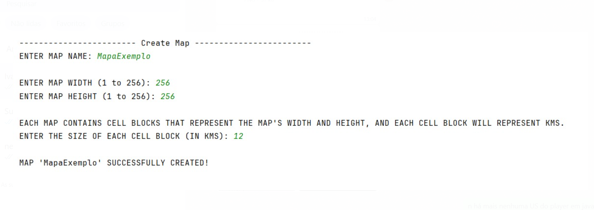
Image 4: Create Map screen

### Display Map List

This feature allows you to view all the maps that have been created.

Step 1: Select "Display Map List" from the Editor Menu.

Step 2: The system will display a list of all available maps with their names and dimensions.

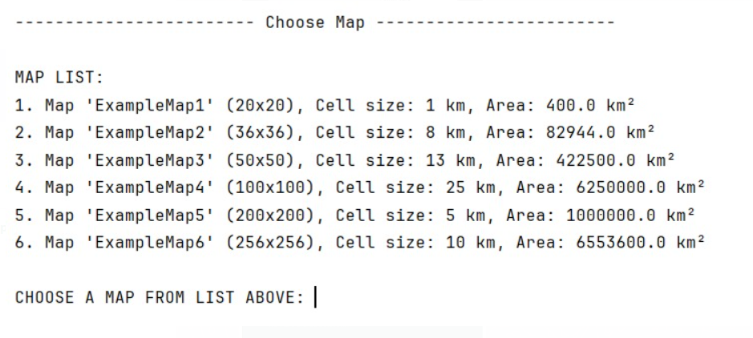
Image 5: Display Map List screen

### Create Scenario

This feature allows you to create a scenario for the current map, defining various restrictions.

Step 1: Select "Create a Scenario" from the Editor Menu for Maps.

Step 2: Define the available locomotion types (steam, diesel, and/or electric).

Step 3: Define the factors that alter the generation frequency of generating industries.

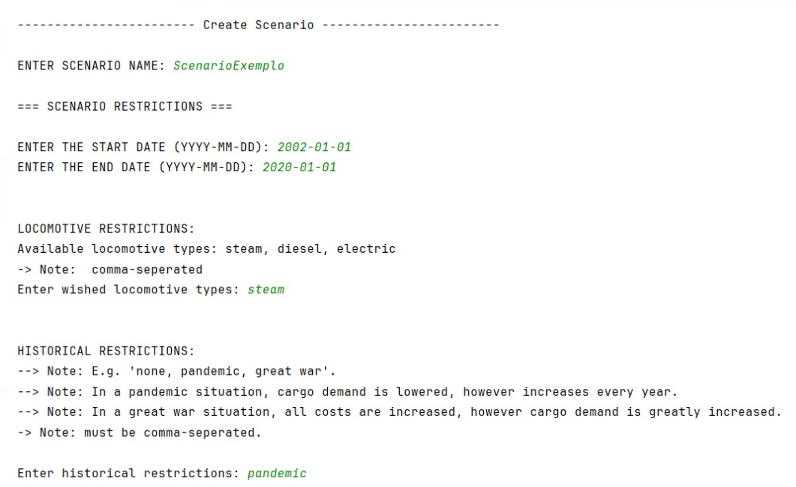
Image 6: Create Scenario screen

Step 4: Define the behavior of ports, including which cargoes they import/export and/or transform.

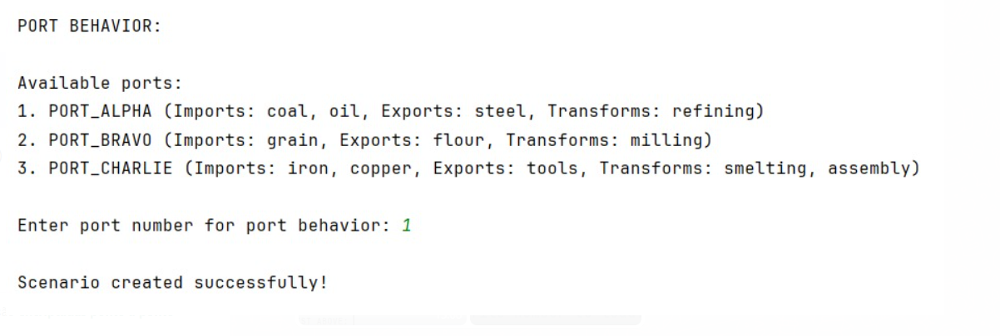
Image: Port Behavior Configuration screen

### Add City

This feature allows you to add a city to the current map.

Step 1: Select "Add a City" from the Editor Menu for Maps.

Step 2: Enter the name of the city (cannot contain special characters or digits).

Step 3: Enter the X and Y coordinates for the city's position on the map.

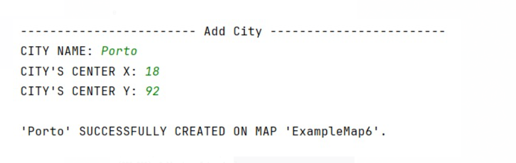
Image 7: Add City screen

Step 4: Enter the number of house blocks for the city, or select to generate them automatically.

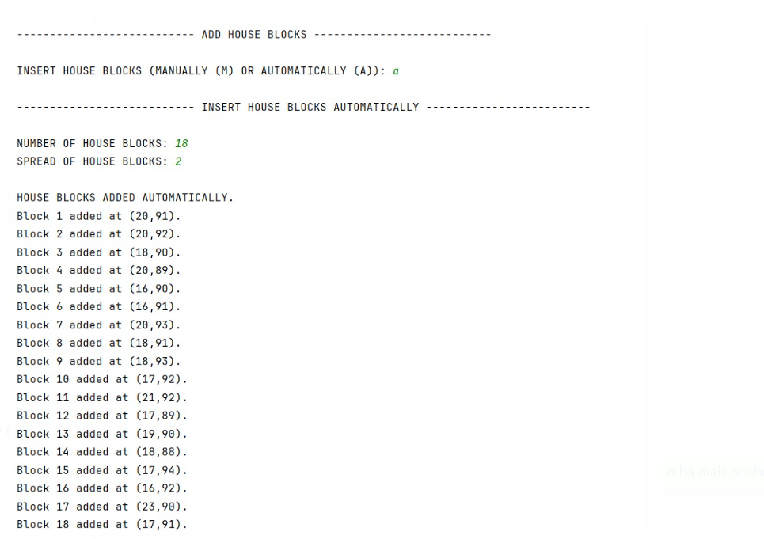
Image: Add City House Blocks screen

Step 2: Add house blocks as needed on the map.

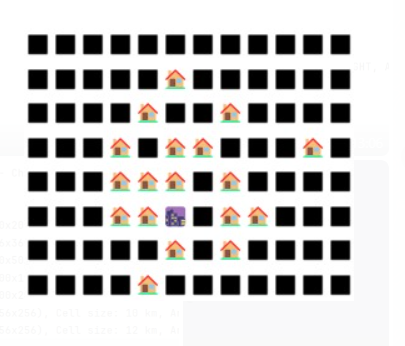
Image: House Blocks Added screen

### Add Industry

This feature allows you to add an industry to the current map.

Step 1: Select "Add an Industry" from the Editor Menu for Maps.

Step 2: Enter the X and Y coordinates for the industry's position on the map.

Step 3: Select the type of industry from the available options.

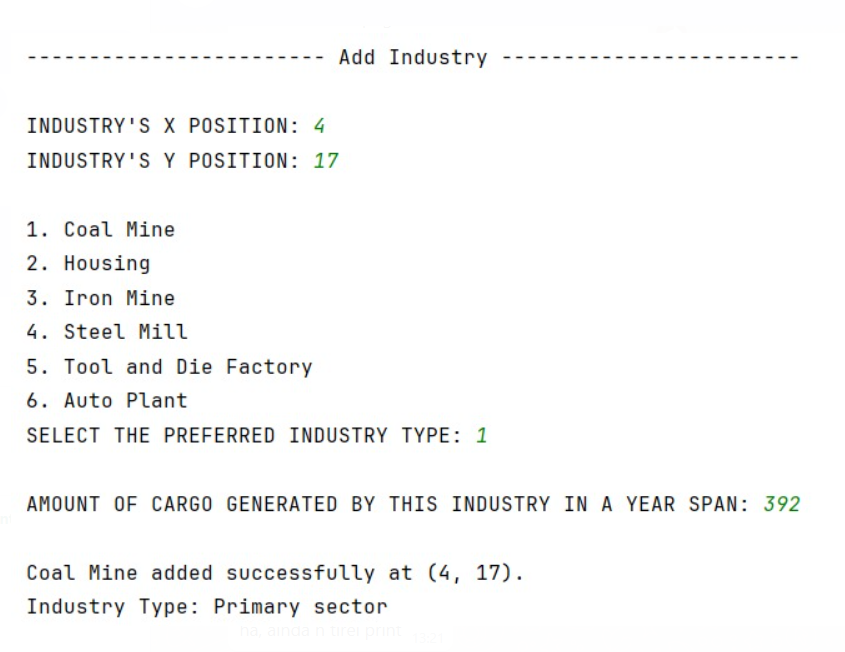
Image 8: Add Industry screen

### Load Map from File

This feature allows you to load a map from a file when choosing a map at login.

Step 1: Select "Load Map from File" when prompted to choose a map.

Step 2: Select one of the available map files to load.

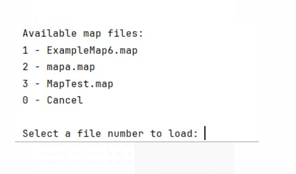
Image: Load Map from File screen

### Save Map to File

This feature allows you to save the current map to a file.

Step 1: Select "Save Map to File" from the Editor Menu for Maps.

Step 2: The current map will be saved to a file.

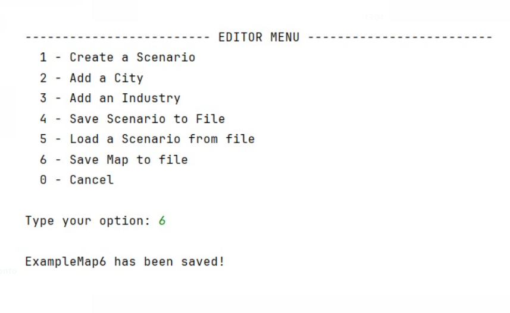
Image: Save Map to File screen

### Save Scenario to File

This feature allows you to save the current scenario to a file.

Step 1: Select "Save Scenario to File" from the Editor Menu for Maps.

Step 2: The current scenario will be saved to a file.

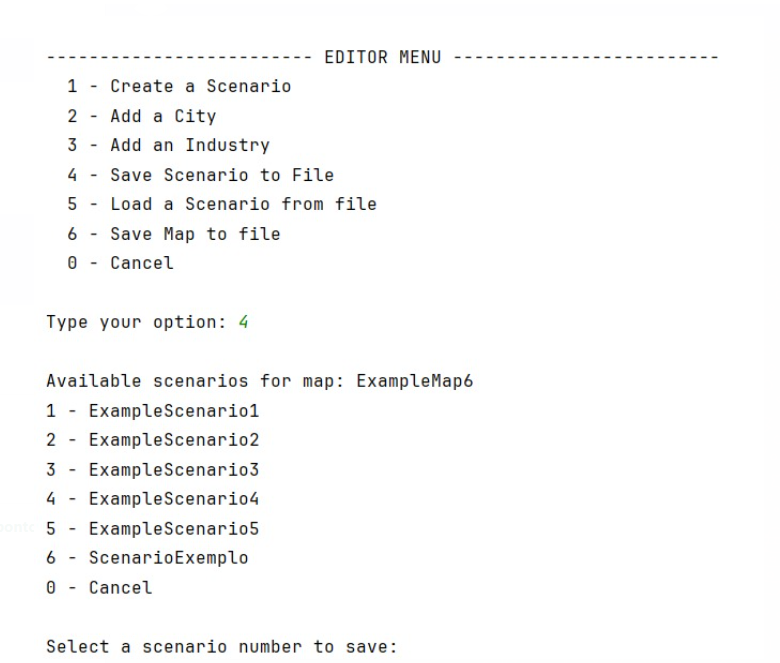
Image: Save Scenario to File screen

### Load Scenario from File

This feature allows you to load a scenario from a file for the current map.

Step 1: Select "Load Scenario from File" from the Editor Menu for Maps.

Step 2: Select one of the available scenario files to load.

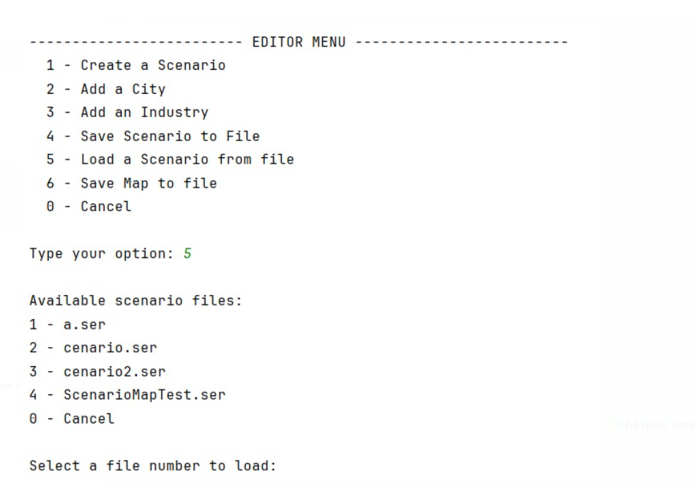
Image: Load Scenario from File screen

## Player Role

After logging in as a Player, you will first need to choose a scenario to play with before accessing the Player Menu functionalities.

Step 1: Select a scenario from the list of available scenarios.

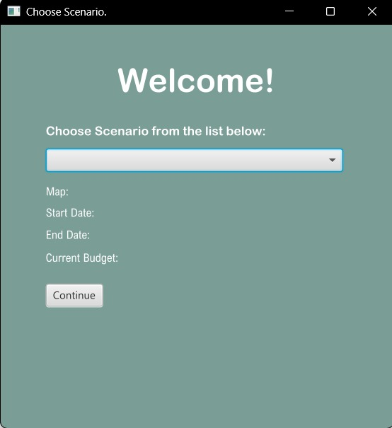
Image 9: Choose Scenario screen

Step 2: After selecting a scenario, you will have access to the Player Menu with the following options:

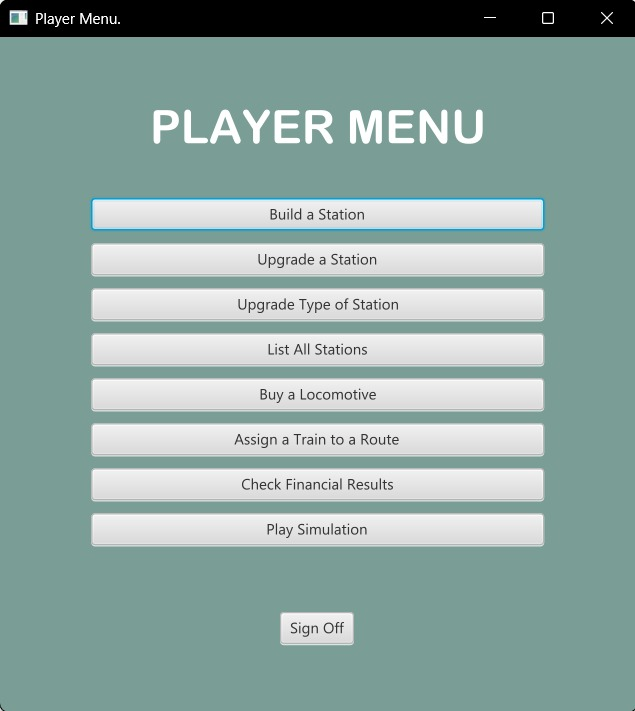
Image 10: Player Menu

### Build Station

This feature allows you to build a station on the current map.

Step 1: Select "Build a Station" from the Player Menu.

Step 2: Select the type of station (Depot, Station, or Terminal).

Step 3: Enter the X and Y coordinates for the station's position on the map.

Step 4: If building a Station, select the center position (NE, SE, NW, SW).

Step 5: The system will propose a name for the station based on the closest city.

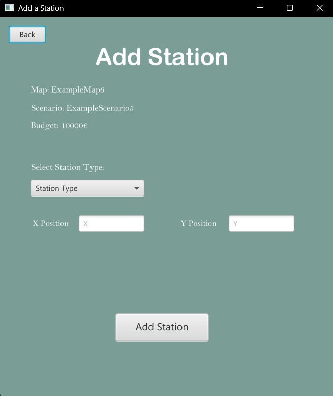
Image 11: Build Station screen

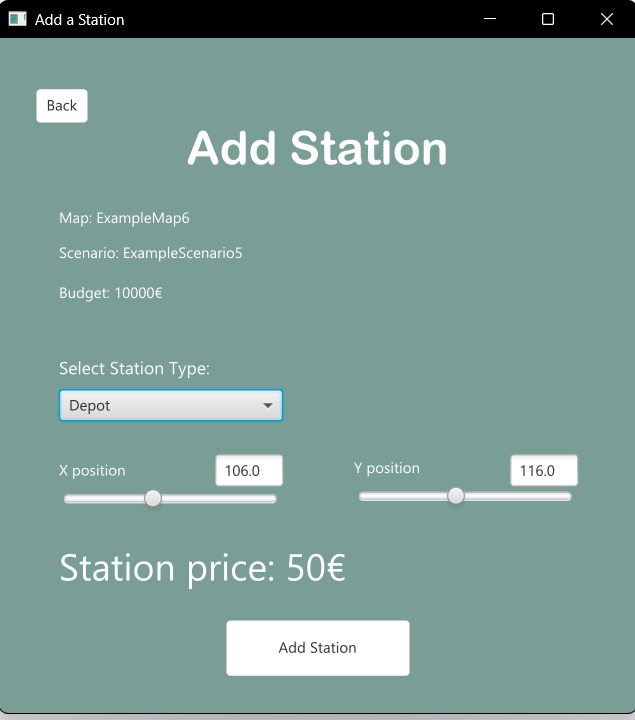

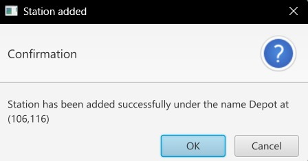

### Upgrade Station

This feature allows you to upgrade a selected station with a building.

Step 1: Select "Upgrade a Station" from the Player Menu.

Step 2: Select a station from the list of available stations.

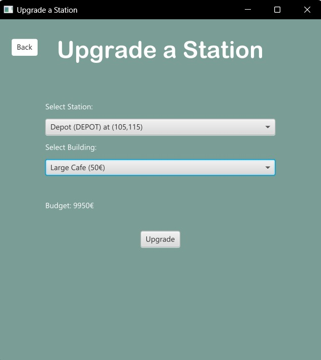
Image 12: Station Selection screen

Step 3: Select a building type to add to the station from the list of available building types.

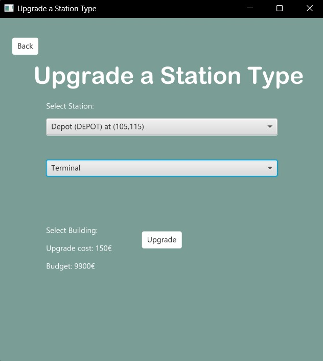
Image 13: Building Type Selection screen

Step 4: Select a specific building to add to the station from the list of available buildings of the selected type.

Image 14: Upgrade Station screen

Step 5: Confirm the upgrade. The system will display a success message once the station has been upgraded.

Image 15: Upgrade Station Success screen

### Check Station Details

This feature allows you to view the details of a selected station.

Step 1: Select "Check Station Details" from the Player Menu.

Step 2: Select a station from the list of available stations.

Step 3: The system will display the station's details, including its buildings and the demand/supply cargoes.

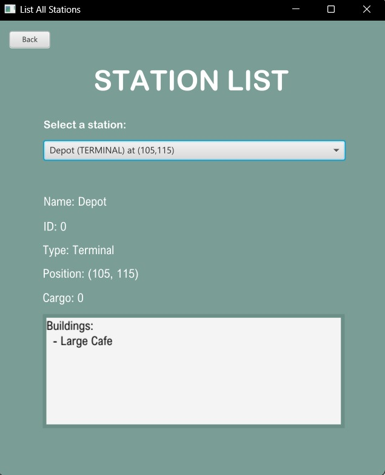
Image 16: Check Station Details screen

### Buy Locomotive

This feature allows you to buy a locomotive.

Step 1: Select "Buy a Locomotive" from the Player Menu.

Step 2: Select a locomotive from the list of available locomotives for the current scenario.

Step 3: The system will display the locomotive's details, including its model, fuel type, speed, and price.

Step 4: Confirm the purchase.

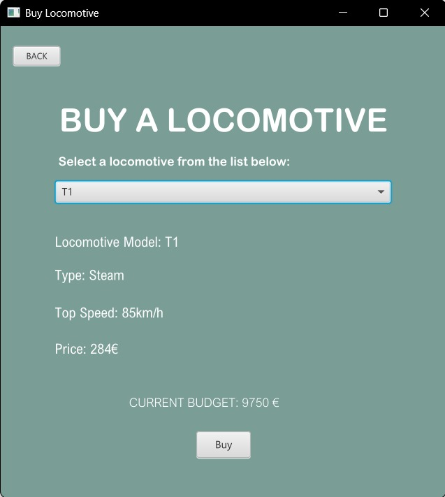
Image 17: Buy Locomotive screen

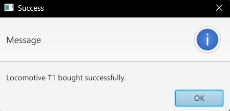
Image 18: Buy Locomotive Success screen

### Assign Train to Route

This feature allows you to assign a train to a route with specific stations and cargoes.

Step 1: Select "Assign a Train to a Route" from the Player Menu.

Step 2: Select a train from the list of available trains.

Step 3: Select the stations that will be part of the route.

Step 4: For each station, select the cargoes to be picked up.

Step 5: Confirm the route assignment.

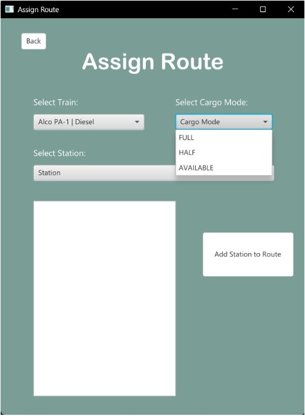
Image 19: Assign Train to Route screen

### Start Simulation 

This feature allows you to begin the operation of your assigned train routes, simulating the transportation of cargoes between the selected stations.

Step 1: Select **"Start Simulation"** from the Player Menu.

Step 2: Review the list of assigned trains and their routes.

Step 3: Choose the train or trains you want to include in the simulation.

Step 4: Click **"Start"** to initiate the simulation process.

Step 5: Monitor the trains as they move along their routes, picking up and delivering cargoes at each station.

Image 20: Simulation in Progress screen

During the simulation, you can view real-time status updates for each train, including current location, cargo load, and estimated time to arrival at the next station.

# Troubleshooting

This section provides solutions to common problems that users may encounter while using the Railway Network Simulation System.

## Problem: Unable to login

**Solution**:
- Ensure that you are entering the correct email and password.
- Check if your password meets the requirements: seven alphanumeric characters, including three capital letters and two digits.
- If you have forgotten your password, you will need to create a new user.

## Problem: Cannot create a map

**Solution**:
- Ensure that the map name is unique and valid.
- Make sure the width and height values are positive integers not exceeding 256.

## Problem: Cannot build a station

**Solution**:
- Ensure that the position is within the map boundaries.
- Check that there is no overlap with existing stations or other elements.
- Verify that you have sufficient budget to build the station.

## Problem: Cannot buy a locomotive

**Solution**:
- Ensure that you have sufficient budget to purchase the locomotive.
- Check that the locomotive is available in the current scenario.

# Frequently Asked Questions

**Q: How do I create a new map?**
A: From the Editor Menu, select "Create Map" and follow the prompts to enter the map name, width, and height.

**Q: How do I add a city to a map?**
A: From the Editor Menu, select "Add a City", choose a map, enter the city name and position, and specify the number of house blocks.

**Q: How do I build a railway network?**
A: As a Player, you can build stations, connect them with railway lines, buy locomotives, and assign them to routes.

**Q: How do I simulate railway operations?**
A: After setting up your railway network, the simulator will automatically generate cargoes at stations based on the cities and industries they serve.

**Q: Can I upgrade my stations?**
A: Yes, you can upgrade stations by adding buildings such as telegraph, café, customs, post office, hotel, silo, or liquid storage.

# Glossary

| **_Term_** (EN)                | **_Term_** (PT)                           | **_Description_** (EN)                                                                                                        |  
|:-------------------------------|:------------------------------------------|:-------------------------------------------------------------------------------------------------------------------------------|  
| **Application**                | **Aplicação**                             | A software program designed to perform specific tasks for the user.                                                            |  
| **Budget**                     | **Orçamento**                             | Financial plans that outline expected revenues and expenditures over a specific period.                                        |  
| **Building**                   | **Edifício**                              | A structure that can be constructed at a station to provide specific effects or capabilities.                                  |
| **Cargo**                      | **Carga**                                 | Goods or materials transported by trains.                                                                                      |  
| **Cargo Demand**               | **Demanda de carga**                      | The amount of cargo a station needs to receive.                                                                                |  
| **Cargo Supply**               | **Fornecimento de Carga**                 | The amount of cargo a station can provide.                                                                                     |  
| **Carriages**                  | **Carruagens**                            | The parts of a train that carry passengers or cargo.                                                                           |  
| **City**                       | **Cidade**                                | A populated area that can be placed on the map, consisting of a center position and house blocks.                              |  
| **Diesel**                     | **Diesel**                                | A type of locomotive powered by a diesel engine.                                                                               |  
| **Economic Radius**            | **Raio Econômico**                        | The area of influence of a station, where cities and industries supply and demand cargo.                                       |  
| **Editor**                     | **Editor**                                | A user role with permissions to create and modify maps and scenarios.                                                          |
| **Electric**                   | **Elétrica**                              | A type of locomotive powered by electricity, requiring electrified railway tracks.                                             |  
| **Financial Results**          | **Resultados Financeiros**                | A record of financial performance including expenses and revenues for a specific period.                                       |
| **Historical Restrictions**    | **Restrições Históricas**                 | Historical events that change the operating conditions of the simulator.                                                       |  
| **House Block**                | **Bloco de Casa**                         | A single block within a city's grid, identified by its x and y coordinates.                                                    |
| **Industry**                   | **Indústria**                             | A static element that produces or transforms resources.                                                                        |  
| **Locomotive**                 | **Locomotiva**                            | The engine part of a train that provides the power to move the train along the tracks.                                         |  
| **Locomotive Types**           | **Tipos de locomotivas**                  | Different types of locomotives, such as steam, diesel, and electric.                                                           |  
| **Map**                        | **Mapa**                                  | The playable area where cities, industries, and stations are placed.                                                           |  
| **Mixed Industries**           | **Indústrias Mistas**                     | Industries that combine characteristics of different sectors.                                                                  |  
| **Player**                     | **Jogador**                               | The user interacting with the simulation.                                                                                      |  
| **Primary Sector Industries**  | **Indústrias do setor primário**          | Industries that generate natural resources, such as mines and farms.                                                           |  
| **Railway**                    | **Ferrovia**                              | A system of tracks, stations, and trains used for transporting goods and passengers.                                           |  
| **Route**                      | **Rota**                                  | The path the train will take.                                                                                                  |  
| **Scenario**                   | **Cenário**                               | A specific configuration of the simulation including time, technological, and historical restrictions.                         |
| **Simulator**                  | **Simulador**                             | A software tool that replicates real-world processes or systems.                                                               |  
| **Station**                    | **Estação**                               | A location where trains stop to load or unload cargo and passengers.                                                           |  
| **Steam**                      | **Vapor**                                 | A type of locomotive powered by steam, typically using coal or wood as fuel.                                                   |  
| **Technological Restrictions** | **Restrições Tecnológicas**               | Types of locomotives available in the scenario.                                                                                |  
| **Time Restrictions**          | **Restrições Temporais**                  | The period in which the simulation will take place.                                                                            |  
| **Track**                      | **Trilho**                                | The metal rails on which trains run.                                                                                           |  
| **Train**                      | **Comboio**                               | A vehicle composed of locomotives and carriages, used to transport cargo or passengers.                                        |  
| **Transforming Industries**    | **Indústrias de transformação**           | Industries that process raw materials into finished products.                                                                  |  
| **Authentication**             | **Autenticação**                          | The process of verifying the identity of a user and their access rights to the system.                                         |
| **CargoType**                  | **Tipo de Carga**                         | Specific categories of cargo including passengers, mail, coal, iron ore, steel, and cars.                                      |
| **Expenses**                   | **Despesas**                              | Costs incurred in running the railway system, including track maintenance, train maintenance, and fuel costs.                  |
| **Password**                   | **Senha**                                 | A security credential used for user authentication.                                                                            |
| **Revenues**                   | **Receitas**                              | Income generated from cargo deliveries and other railway operations.                                                           |
| **Depot**                      | **Depósito**                              | A type of station specialized in storing and maintaining trains.                                                               |
| **RegularStation**             | **Estação Regular**                       | A standard type of station that handles both passenger and cargo operations.                                                   |
| **Terminal**                   | **Terminal**                              | A type of station that serves as an endpoint for train routes.                                                                 |

